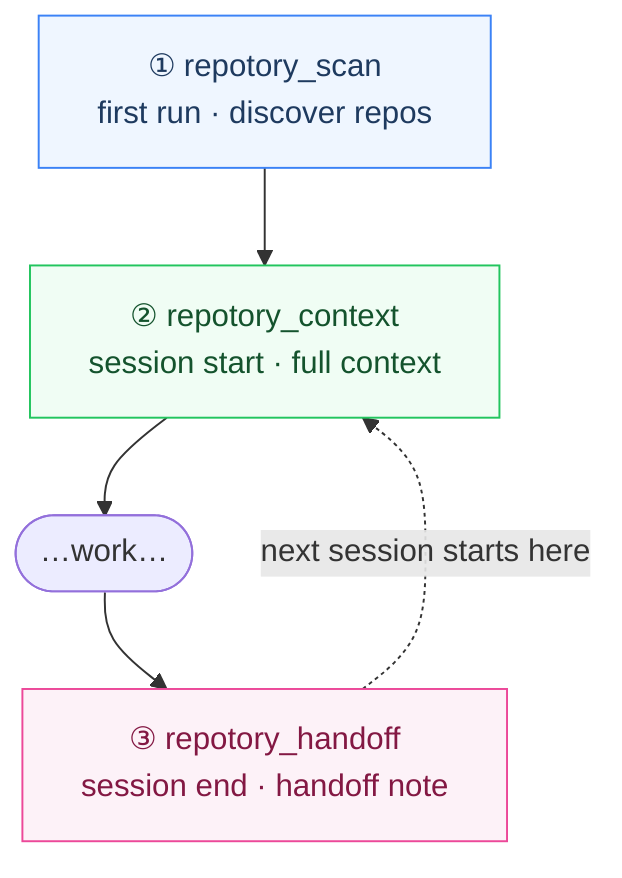

<p align="center">
  
</p>

<h1 align="center">Repotory</h1>

<p align="center">
  <b>The local-first memory layer for AI coding agents.</b><br/>
  Your agents read code brilliantly and forget everything the moment the session ends —<br/>
  why a decision was made, what gotcha was discovered, what to do next.<br/>
  Repotory keeps that knowledge on your machine, searchable and versioned,<br/>
  and hands it back to <i>any</i> agent in one tool call.
</p>

<p align="center">
  <a href="https://github.com/sky-jiangcheng/repotory/releases"></a>
  <a href="https://github.com/sky-jiangcheng/repotory/actions/workflows/release.yml"></a>
  <a href="https://github.com/sky-jiangcheng/repotory/actions/workflows/ci.yml"></a>
  <a href="https://github.com/sky-jiangcheng/repotory/actions/workflows/install-smoke.yml"></a>
  
  
  <a href="./LICENSE"></a>
  
</p>

<p align="center">
  English | <a href="README.zh-CN.md">简体中文</a> · <a href="https://sky-jiangcheng.github.io/repotory/">Documentation</a>
</p>

<p align="center">
  
</p>

<p align="center">
  <sub>A single-file Wails v2 desktop app (Go + React, embedded SQLite, zero CGO) for macOS / Windows / Linux —<br/>
  plus an independently distributed MCP server so any AI agent reads the same local database.</sub>
</p>

---

## Why Repotory?

- **Memory across agents, not inside them.** Claude Code writes a handoff; Cursor reads it tomorrow. Nothing is trapped in one tool's private memory format.
- **Local-first, no cloud, no account.** One SQLite file on your disk. Works fully offline. Nothing leaves the machine unless you explicitly configure an outbound endpoint.
- **Human-gated knowledge.** The LLM wiki compiler drafts pages as *pending*; you approve, reject or merge them in the review queue. Machine-written knowledge never enters search behind your back.

## Table of Contents

- [Quick Start](#quick-start)
- [The loop](#the-loop)
- [Screenshots](#screenshots)
- [Features](#features)
- [VS Code Extension (preview)](#vs-code-extension-preview)
- [Building from Source](#building-from-source)
- [Project Layout](#project-layout)
- [Naming Layers](#naming-layers)
- [Documentation](#documentation)
- [Contributing](#contributing)
- [License](#license)

## Quick Start

### Install

Get the latest build for your platform from [Releases](https://github.com/sky-jiangcheng/repotory/releases).

**Option 1: direct download**

| Platform | Assets |
|----------|--------|
| macOS | `repotory-darwin-arm64.dmg` / `repotory-darwin-amd64.dmg` |
| Linux | `repotory-linux-amd64.tar.gz` |
| Windows | `repotory-windows-amd64.zip` |

**Option 2: one-line install script** (desktop app + `repotory-mcp` together)

| Platform | Command | Installs to |
|----------|---------|-------------|
| macOS | `curl -fsSL https://raw.githubusercontent.com/sky-jiangcheng/repotory/master/scripts/install.sh \| bash` | `/Applications/Repotory.app` + `/usr/local/bin/repotory-mcp` |
| Linux | same | `/usr/local/bin/repotory` + `/usr/local/bin/repotory-mcp` |
| Windows | `iwr -useb https://raw.githubusercontent.com/sky-jiangcheng/repotory/master/scripts/install.ps1 \| iex` | `%LOCALAPPDATA%\Repotory` (added to user PATH automatically) |

**Option 3: package managers**

```bash
# macOS (desktop app)
brew tap sky-jiangcheng/repo && brew install --cask sky-jiangcheng/repo/repotory
# Windows (desktop app)
scoop bucket add repo https://github.com/sky-jiangcheng/scoop-repo && scoop install repo/repotory
```

Manifests live in [`packaging/`](packaging/README.md) — versions derive from `wails.json`, `sha256` values come from the actual release assets (by design: a checksum mismatch must fail the install).

Launch opens a desktop window directly (a Wails app — no browser needed):

1. First launch seeds the default scan roots automatically (HOME on macOS/Linux; all non-system drives on Windows)
2. Click **Rescan** on the dashboard to discover repos — at this point the **knowledge base is already usable**: write/search notes, hand them to AI
3. (Optional, affects dashboard stats only) star the repos you care about → **Backfill history** fetches 365 days of stats

> **Only want the AI side?** No desktop app needed: install `repotory-mcp`, then have your agent call `repotory_scan` once to bootstrap the knowledge base.

More in [Getting Started](docs/en/getting-started.md).

> **CLI tools** (opt-in, advanced): `go run ./cmd/vector-init` — guided setup of the vector store (local default / remote Qdrant / Weaviate) + embedding provider; `repotory-capture` — the Claude Code SessionEnd hook target that auto-captures a closed session; `go run ./cmd/abeval -cases queries.jsonl` — the A/B gate that decides whether semantic search earns enabling. All read the same local database; see [ADR-0013](docs/adr/0013-vector-database-selection.md).

### Set Up the AI Execution Interface (`repotory-mcp`)

AI clients talk to the independently distributed `repotory-mcp` (an MCP stdio server) — **no desktop app required**; it reads the same local database. The install script above sets it up too; you can also install it standalone:

| Method | Platform | Command |
|--------|----------|---------|
| Manual (no prerequisites) | All platforms | Download `repotory-mcp-<target>.tar.gz` / `.zip` from [Releases](https://github.com/sky-jiangcheng/repotory/releases) |
| Homebrew | macOS | `brew tap sky-jiangcheng/repo && brew install --cask sky-jiangcheng/repo/repotory-mcp` |
| Homebrew | Linux | `brew tap sky-jiangcheng/repo && brew install sky-jiangcheng/repo/repotory-mcp` |
| Scoop | Windows | `scoop bucket add repo https://github.com/sky-jiangcheng/scoop-repo && scoop install repo/repotory-mcp` |

Then register it with your AI client — one command covers Claude Code / Cursor / VS Code / Windsurf (step one of [ADR-0009](docs/adr/0009-ide-presence.md), idempotent):

```bash
node scripts/repotory-init/index.mjs --with-hook
```

Or register Claude Code only:

```bash
claude mcp add repotory -- "$(which repotory-mcp)"
```

#### See it work in 30 seconds

After registering, one step remains on first use:

> **First use** (bootstrap the knowledge base, no desktop app needed):
> The agent calls `repotory_scan()` — seeds default scan roots and scans, returning your local repo list in one shot.

Every work session then follows this rhythm:

> **Session start** (a new agent takes over the project):
> "Continue working on the auth project."
>
> The agent calls `repotory_context({ project_name: "auth" })` — tech stack, todos, and the last session's handoff note in one call, then gets straight to work.

> **Session end** (knowledge doesn't evaporate):
> The agent calls `repotory_handoff({ project_id: 1, summary: "Finished the OAuth migration", gotchas: ["the production cookie key needs rotating"], next_steps: ["run the regression suite"] })` — the next session (even from Cursor) continues from here automatically.

Any time in between you can just ask:

> "What local projects do I have? What did I note down about auth?"

The agent chains `repotory_projects_list` → `repotory_notes_search` → `repotory_notes_read`; new conclusions go back with `repotory_notes_create`. The full tool list and workflows live in [SKILL.md](SKILL.md).

### Data Directory

Configuration and the database live in the per-user app data directory (schema migrates automatically on upgrade):

- **macOS**: `~/Library/Application Support/repotory/repotory.db`
- **Windows**: `%APPDATA%/repotory/repotory.db`
- **Linux**: `~/.config/repotory/repotory.db`

Daily snapshots live next to it in `backups/`. Log paths: see [Troubleshooting](docs/en/troubleshooting.md).

## The loop

The whole product is one loop — three tool calls at session boundaries, and every agent that comes after you reuses what the last one left behind:



The dashed edge is the point: handoffs are stored in local SQLite, not in any agent's private memory, so the loop closes across agents — Claude Code writes the handoff, Cursor reads it.

How the human side, the agent side and the local core fit together — and where `repotory-init` sits: see [Architecture](docs/en/architecture.md).

> **Why Repotory?** Coding agents don't retain *the judgment you've accumulated across these repos*: why something was designed this way, what gotcha you hit last time, what the next todo is. Repotory sinks all of that into a local, searchable memory layer that any agent can read and write — `repotory_context` injects it at session start, `repotory_handoff` captures it at session end, and everything in between is retrieved on demand.
> For positioning priorities, feature tiers and the scope freeze, see [ADR-0006](docs/en/adr/0006-scope-freeze.md) and the [positioning brief](docs/positioning-brief.md) (Chinese).

## Screenshots

<table>
  <tr>
    <td width="50%"></td>
    <td width="50%"></td>
  </tr>
  <tr>
    <td align="center"><sub><b>Knowledge base</b> — notes from imports, handoffs and your own writing, one searchable stream</sub></td>
    <td align="center"><sub><b>Project detail</b> — mining, activity and accumulated knowledge per repository</sub></td>
  </tr>
</table>

## Features

> Full feature tables with tier legend and ADR links: [docs/en/features-overview.md](docs/en/features-overview.md). Tier model: **Core** (completes the discover → understand → record → retrieve → AI loop) · **Support** (makes the loop legible) · **Experimental** (kept, not expanded) · **Paused** (no further investment) — see [ADR-0006](docs/en/adr/0006-scope-freeze.md).

- **Knowledge base (Core)** — Markdown notes with a `/` block editor, FTS5 trigram search, per-save version history with line-level diff, global ⌘/Ctrl+K search
- **AI-ready interfaces (Core)** — `repotory-mcp` (13 MCP tools), one-call `repotory_context` / `repotory_handoff`, llms.txt, 8 built-in memory importers (Claude / Codex / OpenCode / CodeBuddy / Cursor / OpenClaw / Hermes…), OMP-style export, a data-integrity audit (`repotory_integrity`)
- **Knowledge graph & LLM wiki (Support, human-gated)** — notes compile into wiki pages as *pending* drafts; review queue (approve / reject / merge, tombstones); page versions; merge suggestions; community summaries; graph-aware evidence; hybrid semantic search with a pluggable vector store (sqlite-vec default, Qdrant / Weaviate remote) — every LLM path is an opt-in gate, off by default
- **Built-in backups (Core)** — daily `VACUUM INTO` snapshots (on by default, 14 kept, 0600); restore = copy one file back; off-machine push shaped in [ADR-0025](docs/en/adr/0025-backup-recovery.md) L2
- **Repository mining (Core)** — README summary, tech stack (20+ manifest formats), language shares, dependencies, contributors, activity, commit stream — cached per repository
- **Dashboard & stats (Support)** — goal ring, trends, heatmap, starring, smart grouping, workday alerts, live status bar, theme switcher

## VS Code Extension (preview)

The extension (VS Code / Cursor / Windsurf — one VSIX covers all three) is a **preview**. Every product release automatically publishes it to the [Marketplace](https://marketplace.visualstudio.com/items?itemName=sky-jiangcheng.repotory-vscode) (active once the `VSCE_PAT` secret is configured); the `.vsix` is also attached to each [Release](https://github.com/sky-jiangcheng/repotory/releases) for manual install, and you can always package from source:

```bash
git clone https://github.com/sky-jiangcheng/repotory.git
cd repotory/ide/vscode
npm install
npx @vscode/vsce package --no-dependencies   # → repotory-vscode-2.9.0.vsix
```

Then install the produced `.vsix`:

- **UI**: Extensions view → `⋯` menu → **Install from VSIX…**
- **CLI**: `code --install-extension repotory-vscode-2.9.0.vsix` (use `cursor` / `windsurf` for the forks)

The extension is a thin client: commands call `repotory-mcp` over stdio (install it first — brew / scoop / [Releases](https://github.com/sky-jiangcheng/repotory/releases)), and all answers come from the same `internal/service` layer as the desktop app. Capability details in [`ide/vscode/README.md`](ide/vscode/README.md).

## Building from Source

Requirements: **Go 1.26+**, **Node.js 20+** (frontend build), optional [Wails CLI](https://wails.io) v2.13+.

```bash
# Frontend deps & build (web/dist is go:embed-ed into the binary)
cd web && npm install && npm run build && cd ..

# Desktop app
go build -ldflags "-s -w" -o repotory .

# MCP server
go build -o repotory-mcp ./cmd/mcp/

# Or use the script
./scripts/build.sh
```

Dev mode: `wails dev` (frontend hot reload + Wails binding injection). Browser-mode dev stack: `bash scripts/dev.sh` (headless API on :18765 + Vite on :5173).

Tests & checks:

```bash
go test ./...            # full Go test suite (service/db/knowledge/scanner/diff…)
cd web && npm test       # vitest
cd web && npm run build  # strict tsc check + production build
cd web && npm run lint   # eslint
```

## Project Layout

```
main.go                  # Wails entry: DB init, scan-root seeding, window & security headers
internal/
  app/                   # Wails binding layer: each method delegates 1-3 lines to service
  service/               # Business core: scan pipeline, stats refresh, projects/notes/search/export
                          #   (Wails desktop, CLI and MCP share the same implementation)
  domain/                # Row types shared across layers
  db/                    # SQLite: schema/migrations + domain-split queries (projects/notes/…)
  core/git/              # Git provider abstraction (local CLI implementation)
  core/plugin/           # Knowledge-importer SPI (source registration, probe, import runs)
  importers/             # Per-source readers: claude / codex / opencode / codebuddy / cursor / openclaw / hermes
  graph/                 # Pure-Go Label Propagation + PPR for the knowledge graph
  integrity/             # Read-only data-integrity checks behind repotory_integrity
  stats/ knowledge/      # git log stats, repository mining
  scanner/ grouper/      # filesystem scanning, project grouping
  platform/              # OS differences: data dirs, log paths, default scan roots
  version/ diff/         # single version source, note line-level diff
cmd/
  mcp/                   # MCP stdio server (AI execution interface + agent-score self-check tools)
  server/                # Headless HTTP API (browser mode, CI smoke)
web/src/
  api/                   # types + transport (Wails/HTTP dual-mode) + endpoints
  hooks/                 # useApiData (cache) / useDebouncedCallback / useScanPolling…
  pages/ components/     # pages & components (large pages split into domain subdirs)
  locales/ styles/       # zh-CN + en; design-system CSS
```

Architecture decisions: see the [ADRs](docs/en/adr/index.md), especially [ADR-0005 service-layer refactor](docs/en/adr/0005-service-layer.md); layering and data flows in [Architecture](docs/en/architecture.md). The frontend/backend contract (Wails binding surface) is in [API Reference](docs/en/api/reference.md).

## Naming Layers

The brand name and machine identifiers are **deliberately separate layers**: the display layer exists to be remembered, the identifier layer to stay stable (URLs, upgrade paths, data migrations and external contracts do not follow brand wording).

| Layer | Value | Used for |
|-------|-------|----------|
| Brand (display) | `Repotory` | `productName`, in-app logo, docs and UI copy |
| Full display name | `Repotory: Local Git Knowledge Base` | Window title, HTML `<title>`, README title |
| Repo & package identifier | `repotory` | GitHub repo name, Go module name, npm package names, docs site URL |
| Identifiers deliberately frozen against the brand | `repotory` | Command / binary name (`outputfilename`), user data directory, MCP server name `repotory-mcp` and tool prefix `repotory_*` |

Why frozen: the data directory has already been through two automatic migrations (gitboard → gitbuddy → repotory); the `repotory` → `Repotory` rebrand deliberately left it alone, because another rename would mean a third data move. MCP tool names are an external contract with AI clients — renaming breaks existing configs and allowlists. When contributing, please do not "helpfully unify" these names.

## Documentation

English pages are the default; the [Chinese manual](https://sky-jiangcheng.github.io/repotory/zh/) mirrors them. Only the [positioning brief](docs/positioning-brief.md) and [product reviews](docs/product-review/2026-08-27-new-deep-review.md) remain Chinese-only.

| Document | Contents |
|----------|----------|
| [Features Overview](docs/en/features-overview.md) | The full feature tables: every capability, its tier and the ADR behind it |
| [Getting Started](docs/en/getting-started.md) | Install, first-run setup, scanning |
| [Data & Backup](docs/en/data-management.md) | Backup, migrating machines, reset & uninstall |
| [Features](docs/en/features/knowledge.md) | Knowledge base / dashboard / project detail / settings / command palette |
| [Knowledge Sources](docs/en/plugins/overview.md) | Built-in importers, events, per-source behaviour |
| [AI Integration](docs/en/features/ai-integration.md) | CLI, MCP, llms.txt |
| [API Reference](docs/en/api/reference.md) | Wails binding surface contract + OpenAPI |
| [Architecture](docs/en/architecture.md) | Layering, data flows, key decisions |
| [Troubleshooting](docs/en/troubleshooting.md) | FAQ and log paths |
| [SKILL.md](SKILL.md) | Capability card for AI agents |
| [TODO.md](TODO.md) | Known issues and roadmap (Chinese) |

[Online docs](https://sky-jiangcheng.github.io/repotory/) (GitHub Pages, auto-deployed from master).

## Contributing

See [CONTRIBUTING.md](CONTRIBUTING.md) (Chinese) for the dev environment and commit conventions. Quick start:

Requirements: **Go 1.26+**, **Node.js 20+**, Git.

```bash
cd web && npm install && npm run build && cd ..  # frontend build
go test ./...                                     # Go tests
cd web && npm test                                # frontend tests
wails dev                                         # dev mode (optional)
```

Architecture conventions: [docs/architecture.md](docs/en/architecture.md) and [docs/en/adr/](docs/en/adr/index.md). Commits follow [Conventional Commits](https://www.conventionalcommits.org/). Security issues go through the [private reporting channel](SECURITY.md).

## License

[MIT](LICENSE)
