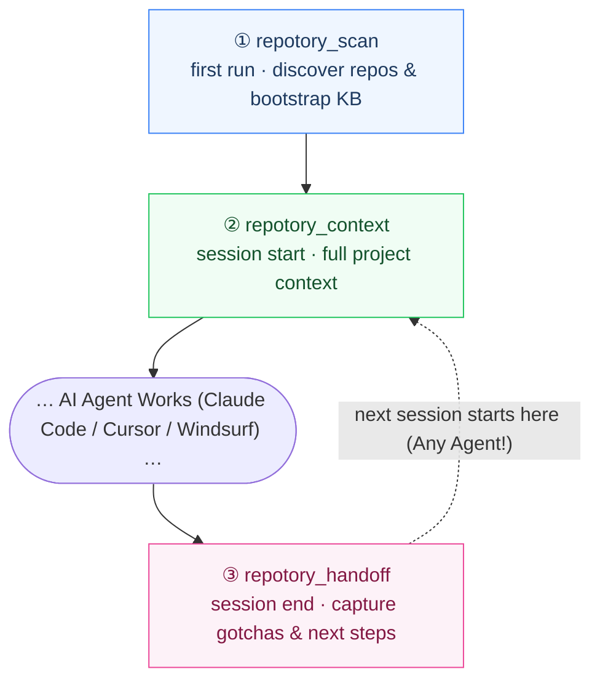

<p align="center">
  <a href="https://github.com/sky-jiangcheng/repotory"></a>
</p>

<h1 align="center">Repotory</h1>

<p align="center">
  <b>The local-first memory layer for AI coding agents.</b><br/>
  Stop agent amnesia. Your agents read code brilliantly, but forget decisions, gotchas, and next steps the moment the session ends.<br/>
  Repotory keeps that knowledge on your machine in SQLite, searchable and versioned,<br/>
  and hands it back to <i>any</i> agent in one tool call.
</p>

<p align="center">
  <a href="https://github.com/sky-jiangcheng/repotory/releases"></a>
  <a href="https://github.com/sky-jiangcheng/repotory/actions/workflows/ci.yml"></a>
  <a href="https://github.com/sky-jiangcheng/repotory/actions/workflows/install-smoke.yml"></a>
  
  
  
  <a href="./LICENSE"></a>
</p>

<p align="center">
  English | <a href="README.zh-CN.md">简体中文</a> · <a href="https://sky-jiangcheng.github.io/repotory/">Documentation</a>
</p>

---

## 🎯 Why Repotory?

AI coding agents are revolutionizing development, but they suffer from **session amnesia** and **tool silos**. Repotory solves this at the local layer:

| The Problem Today | The Repotory Solution |
| :--- | :--- |
| 🔄 **Agent Amnesia & Silos**: Claude Code writes a handoff; Cursor has no clue tomorrow. Knowledge is trapped in private formats. | **Unified Cross-Agent Memory**: One local SQLite database accessible by Claude Code, Cursor, Windsurf, or custom scripts via standard MCP. |
| 💸 **Context Window Bloat**: Every session burns thousands of tokens re-explaining architecture, patterns, and historical gotchas. | **Instant Context Injection (`repotory_context`)**: Injects tech stack, gotchas, active todos, and the last handoff note in a single call. |
| 🔒 **Cloud & Privacy Risks**: Pushing internal codebases, architecture thoughts, and notes to third-party clouds risks data leakage. | **100% Local-First & Zero CGO**: Operates completely offline on your disk. Nothing leaves your machine unless you configure an external endpoint. |
| 🛡️ **Hallucination Pollution**: Autonomous agents silently write bad notes that poison future retrievals. | **Human-Gated Review Queue**: LLM-compiled wiki pages enter as *pending drafts*. You approve, reject, or merge them before they enter search. |

---

## 📦 Ecosystem & Product Matrix

Repotory is engineered as a modular local knowledge suite. Choose the artifact that matches your workflow:

| Artifact | Type | Description & Best For | Quick Access |
| :--- | :--- | :--- | :--- |
| **`repotory-mcp`** | 🤖 Standalone MCP Server | **Core agent memory engine.** Runs via stdio. Connects Claude Code, Cursor, Windsurf, and any MCP client to local memory with **zero desktop app required**. | `node scripts/repotory-init/index.mjs` |
| **Repotory Desktop** | 🖥️ Desktop Application | **Visual workspace & review hub.** Native single-file desktop app (Wails v2 + React 19) for macOS, Windows, and Linux. Browse notes, review LLM wiki drafts, explore repo metrics. | [Releases](https://github.com/sky-jiangcheng/repotory/releases) · `brew` · `scoop` |
| **IDE Extensions** | 🧩 VS Code & JetBrains | **In-editor lookup.** Search notes, todos, and project handoffs directly from your editor sidebar (VS Code / Cursor / Windsurf & IntelliJ family). | [VS Code Marketplace](https://marketplace.visualstudio.com/items?itemName=sky-jiangcheng.repotory-vscode) · JetBrains Plugins |
| **CLI & Headless** | ⚡ Automation & Daemon | **Automated capture & headless mode.** `repotory-capture` (auto-session hook), `repotory-server` (headless API), vector setup, and data integrity audit tools. | Included with install script |

---

## 🚀 Quick Start

### Option A — Connect Your AI Agents (Fastest, No GUI Required)

`repotory-mcp` is an independent stdio server that talks directly to your local database. Register it with Claude Code, Cursor, VS Code, and Windsurf in one command:

```bash
# 1. Install repotory-mcp (macOS / Linux)
curl -fsSL https://raw.githubusercontent.com/sky-jiangcheng/repotory/master/scripts/install.sh | bash

# 2. Automatically register MCP with your installed agents + install SessionEnd hook
node scripts/repotory-init/index.mjs --with-hook

# Or register manually in Claude Code:
claude mcp add repotory -- "$(which repotory-mcp)"
```

### Option B — Install the Desktop App (GUI Workbench)

Prefer a visual dashboard, markdown note editor, and human review queue?

| Method | Command / Download |
| :--- | :--- |
| **Direct Download** | [GitHub Releases](https://github.com/sky-jiangcheng/repotory/releases) — `repotory-darwin-arm64.dmg` / `repotory-linux-amd64.tar.gz` / `repotory-windows-amd64.zip` |
| **Homebrew (macOS)** | `brew install --cask sky-jiangcheng/repo/repotory` |
| **Scoop (Windows)** | `scoop install repo/repotory` |
| **One-Line Script (Windows)** | `iwr -useb https://raw.githubusercontent.com/sky-jiangcheng/repotory/master/scripts/install.ps1 \| iex` |

First launch automatically seeds your scan roots (HOME on macOS/Linux; non-system drives on Windows). Hit **Rescan** on the dashboard and your knowledge base is immediately ready. Full walkthrough: [Getting Started](docs/en/getting-started.md).

---

## 🔄 The Cross-Agent Loop

Three tool calls at session boundaries ensure that every agent that comes after you seamlessly reuses what the last one discovered:



```text
Session Start  repotory_context({ project_name: "auth" })          # Stack, todos, gotchas, last handoff
During Work    repotory_notes_search({ query: "jwt expiry" })      # Retrieve verified project knowledge
Session End    repotory_handoff({ summary, gotchas, next_steps })  # Persist handoff for tomorrow's agent
```

The dashed line is the key: handoffs live in your local SQLite database, not in any agent's private memory. **Claude Code writes the handoff; Cursor reads it tomorrow.**

---

## ✨ Features

> Full feature matrix with tier definitions and ADR links: [docs/en/features-overview.md](docs/en/features-overview.md).

- **Knowledge Base (Core)** — Markdown notes with a `/` block editor, FTS5 trigram search, per-save version history with line-level diff, and global ⌘/Ctrl+K search.
- **AI-Ready Interfaces (Core)** — `repotory-mcp` (13 MCP tools), one-call `repotory_context` / `repotory_handoff`, llms.txt, 8 built-in memory importers (Claude, Codex, OpenCode, CodeBuddy, Cursor, OpenClaw, Hermes…), and data-integrity audit (`repotory_integrity`).
- **Knowledge Graph & LLM Wiki (Support, Human-Gated)** — Notes compile into wiki pages as *pending* drafts; review queue (approve, reject, merge); page versions; community summaries; hybrid semantic search with pluggable vector store (sqlite-vec default, Qdrant / Weaviate remote) — every LLM path is opt-in.
- **Built-in Backups (Core)** — Daily `VACUUM INTO` snapshots (on by default, 14 kept, 0600 permissions); restore is as simple as copying one file back.
- **Repository Mining (Core)** — README summary, tech stack (20+ manifest formats), language shares, dependencies, contributors, and activity cached per repository.
- **Dashboard & Metrics (Support)** — Goal ring, activity trends, git heatmap, repository starring, smart grouping, and theme switcher.

---

## 🧩 IDE Extensions

### VS Code / Cursor / Windsurf Extension

One VSIX covers VS Code, Cursor, and Windsurf as a lightweight client: commands call `repotory-mcp` over stdio and query the local knowledge base directly from your editor.

- Install directly from the [VS Code Marketplace](https://marketplace.visualstudio.com/items?itemName=sky-jiangcheng.repotory-vscode) or download the `.vsix` from [Releases](https://github.com/sky-jiangcheng/repotory/releases).
- Package from source:
  ```bash
  cd ide/vscode && npm install && npx @vscode/vsce package --no-dependencies
  code --install-extension repotory-vscode-*.vsix
  ```
  See [`ide/vscode/README.md`](ide/vscode/README.md) for details.

### JetBrains Plugin

Installs into the IntelliJ family (IDEA, PyCharm, GoLand, WebStorm) using platform APIs. Provides a tool window to search notes and todos directly within your IDE.

- Search for **Repotory** under **Settings | Plugins | Marketplace**, or download the plugin zip from [Releases](https://github.com/sky-jiangcheng/repotory/releases).
- Build from source:
  ```bash
  cd ide/jetbrains && gradle buildPlugin
  ```
  See [`ide/jetbrains/README.md`](ide/jetbrains/README.md) for details.

---

## 🛠️ Building from Source

Requirements: **Go 1.26+**, **Node.js 20+**, optional [Wails CLI](https://wails.io) v2.13+.

```bash
# Frontend build
cd web && npm install && npm run build && cd ..

# Build Desktop App & MCP Server
go build -ldflags "-s -w" -o repotory .
go build -o repotory-mcp ./cmd/mcp/
```

Dev mode: `wails dev` (desktop hot reload) or `bash scripts/dev.sh` (headless API on :18765 + Vite on :5173).

```bash
go test ./...            # Full Go test suite
cd web && npm test       # Vitest suite
cd web && npm run lint   # ESLint
```

---

## 🗂️ Project Layout

```
main.go            # Wails entry: DB init, scan-root seeding, window & security headers
internal/          # app · service (core business logic shared by Desktop, CLI, and MCP) · db · domain
                   # core/git · core/plugin · importers · graph · integrity · stats · knowledge
                   # scanner · grouper · platform · version · diff
cmd/mcp/           # MCP stdio server (AI execution interface & self-check tools)
cmd/server/        # Headless HTTP API daemon (browser mode & CI smoke tests)
web/src/           # React 19 + TypeScript: api · hooks · pages · components · locales · styles
```

Architecture flows: [Architecture](docs/en/architecture.md) · Architecture Decision Records: [ADRs](docs/en/adr/index.md).

---

## 🏷️ Naming Layers

Brand display and machine identifiers are deliberately separated layers:

| Layer | Value | Used for |
| :--- | :--- | :--- |
| **Brand (display)** | `Repotory` | `productName`, in-app logo, documentation, and UI copy |
| **Repo & package identifier** | `repotory` | GitHub repo name, Go module name, npm package names, docs site URL |
| **Frozen identifiers** | `repotory` | Binary name, user data directory, MCP server `repotory-mcp`, tool prefix `repotory_*` |

Data directories and MCP tool names are external contracts with AI clients — when contributing, please preserve frozen identifiers.

---

## 📖 Documentation

English documentation is the primary reference; the [Chinese manual](https://sky-jiangcheng.github.io/repotory/zh/) mirrors it.

| Document | Contents |
| :--- | :--- |
| [Features Overview](docs/en/features-overview.md) | Full feature tables: every capability, its tier, and the ADR behind it |
| [Getting Started](docs/en/getting-started.md) | Install, first-run setup, repository scanning |
| [Data & Backup](docs/en/data-management.md) | Backup, migrating machines, reset & uninstall |
| [Features](docs/en/features/knowledge.md) | Knowledge base, dashboard, project detail, settings, command palette |
| [Knowledge Sources](docs/en/plugins/overview.md) | Built-in memory importers, events, per-source behavior |
| [AI Integration](docs/en/features/ai-integration.md) | CLI, MCP server, llms.txt |
| [API Reference](docs/en/api/reference.md) | Wails binding surface contract + OpenAPI |
| [Architecture](docs/en/architecture.md) | Layering, data flows, key architectural decisions |
| [Troubleshooting](docs/en/troubleshooting.md) | FAQ and log paths |
| [SKILL.md](SKILL.md) | Capability card for AI agents |
| [TODO.md](TODO.md) | Known issues and roadmap |

[Online Documentation](https://sky-jiangcheng.github.io/repotory/) (auto-deployed from master).

---

## 🤝 Contributing

See [CONTRIBUTING.md](CONTRIBUTING.md) for full conventions. Quick check before submitting PRs:

```bash
go test ./...
cd web && npm test && npm run build
node scripts/check-docs-mirror.mjs
node scripts/check-i18n-keys.mjs
```

---

## 📄 License

[MIT](LICENSE) © 2026-present [sky-jiangcheng](https://github.com/sky-jiangcheng) and Repotory contributors.
Repotory is free for personal and commercial use under the MIT License. The `Repotory` name and logo remain trademarks of the project.
