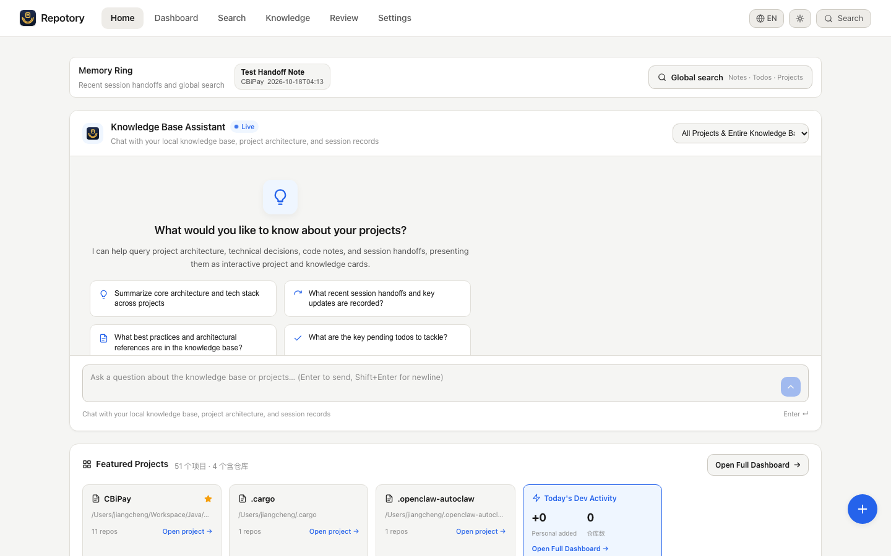
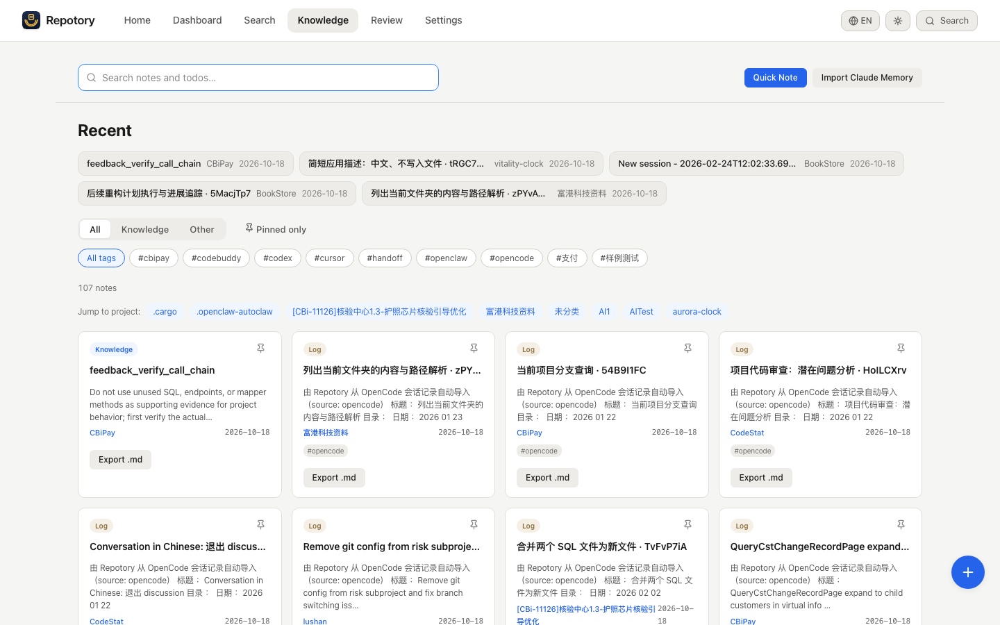
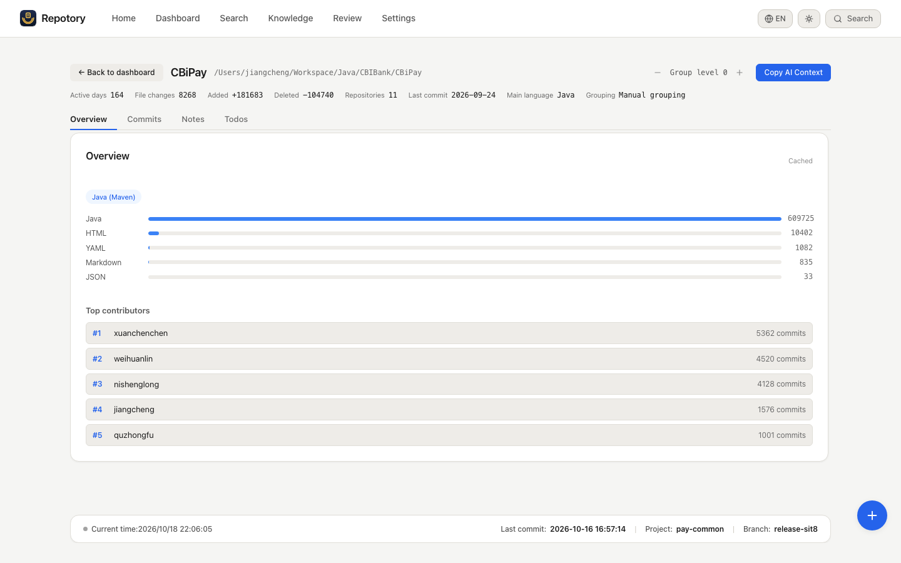

<p align="center">
  
</p>

<h1 align="center">Repotory</h1>

<p align="center">
  <b>The local-first memory layer for AI coding agents.</b><br/>
  Your agents read code brilliantly and forget everything the moment the session ends —<br/>
  why a decision was made, what gotcha was discovered, what to do next.<br/>
  Repotory keeps that knowledge on your machine, searchable and versioned,<br/>
  and hands it back to <i>any</i> agent in one tool call.
</p>

<p align="center">
  <a href="https://github.com/sky-jiangcheng/repotory/releases"></a>
  <a href="https://github.com/sky-jiangcheng/repotory/actions/workflows/release.yml"></a>
  <a href="https://github.com/sky-jiangcheng/repotory/actions/workflows/ci.yml"></a>
  <a href="https://github.com/sky-jiangcheng/repotory/actions/workflows/install-smoke.yml"></a>
  
  
  <a href="./LICENSE"></a>
  
</p>

<p align="center">
  English | <a href="README.zh-CN.md">简体中文</a> · <a href="https://sky-jiangcheng.github.io/repotory/">Documentation</a>
</p>

<p align="center">
  
</p>

<p align="center">
  <sub>A single-file Wails v2 desktop app (Go + React, embedded SQLite, zero CGO) for macOS / Windows / Linux —<br/>
  plus an independently distributed MCP server so any AI agent reads the same local database.</sub>
</p>

---

## Why Repotory?

- **Memory across agents, not inside them.** Claude Code writes a handoff; Cursor reads it tomorrow. Nothing is trapped in one tool's private memory format.
- **Local-first, no cloud, no account.** One SQLite file on your disk. Works fully offline. Nothing leaves the machine unless you explicitly configure an outbound endpoint.
- **Human-gated knowledge.** The LLM wiki compiler drafts pages as *pending*; you approve, reject or merge them in the review queue. Machine-written knowledge never enters search behind your back.

## Quick Start

### 1 — Install

| Method | Command / asset |
|--------|-----------------|
| Direct download | [Releases](https://github.com/sky-jiangcheng/repotory/releases) — `repotory-darwin-arm64.dmg` / `repotory-linux-amd64.tar.gz` / `repotory-windows-amd64.zip` |
| One-line script (macOS / Linux) | `curl -fsSL https://raw.githubusercontent.com/sky-jiangcheng/repotory/master/scripts/install.sh \| bash` — installs the app **and** `repotory-mcp` |
| One-line script (Windows) | `iwr -useb https://raw.githubusercontent.com/sky-jiangcheng/repotory/master/scripts/install.ps1 \| iex` |
| Homebrew / Scoop | `brew install --cask sky-jiangcheng/repo/repotory` · `scoop install repo/repotory` — manifests in [`packaging/`](packaging/README.md) (versions from `wails.json`, checksums from the release assets) |

First launch seeds the default scan roots automatically (HOME on macOS/Linux; non-system drives on Windows). Hit **Rescan** on the dashboard and the knowledge base is immediately usable — write notes, search, hand them to AI. Optionally star repos → **Backfill history** for 365 days of stats. Full walkthrough: [Getting Started](docs/en/getting-started.md).

### 2 — Connect your agent

`repotory-mcp` is a standalone MCP stdio server that reads the same local database — **no desktop app required**. One idempotent command registers it with Claude Code / Cursor / VS Code / Windsurf ([ADR-0009](docs/adr/0009-ide-presence.md)):

```bash
node scripts/repotory-init/index.mjs --with-hook
# Claude Code only:
claude mcp add repotory -- "$(which repotory-mcp)"
```

### 3 — Run the loop

```text
First run      repotory_scan()                                  discover repos, bootstrap the KB
Session start  repotory_context({ project_name: "auth" })       stack, todos, last handoff — straight to work
Session end    repotory_handoff({ summary, gotchas, next_steps }) the next agent continues from here
```

In between, just ask — *"what did I note down about auth?"* — and the agent chains `repotory_projects_list` → `repotory_notes_search` → `repotory_notes_read`, writing new conclusions back with `repotory_notes_create`. Full tool list and workflows: [SKILL.md](SKILL.md).

Everything lives in one SQLite file per user — `~/Library/Application Support/repotory/` (macOS) · `%APPDATA%\repotory\` (Windows) · `~/.config/repotory/` (Linux) — with daily `VACUUM INTO` snapshots in `backups/` beside it (14 kept, 0600; restore = copy one file back). See [Data & Backup](docs/en/data-management.md).

> **CLI tools** (opt-in, advanced): `go run ./cmd/vector-init` — vector store (local / Qdrant / Weaviate) + embedding provider setup; `repotory-capture` — the Claude Code SessionEnd hook target; `go run ./cmd/abeval` — the A/B gate deciding whether semantic search earns enabling. All read the same database — [ADR-0013](docs/adr/0013-vector-database-selection.md).

## The loop

Three tool calls at session boundaries; every agent that comes after you reuses what the last one left behind:


The dashed edge is the point: handoffs live in local SQLite, not in any agent's private memory, so the loop closes **across** agents — Claude Code writes the handoff, Cursor reads it. How the human side, the agent side and the local core fit together — and where `repotory-init` sits: [Architecture](docs/en/architecture.md).

## Screenshots

<table>
  <tr>
    <td width="50%"></td>
    <td width="50%"></td>
  </tr>
  <tr>
    <td align="center"><sub><b>Knowledge base</b> — notes from imports, handoffs and your own writing, one searchable stream</sub></td>
    <td align="center"><sub><b>Project detail</b> — mining, activity and accumulated knowledge per repository</sub></td>
  </tr>
</table>

## Features

> Full feature tables with tier legend and ADR links: [docs/en/features-overview.md](docs/en/features-overview.md). Tier model: **Core** (completes the discover → understand → record → retrieve → AI loop) · **Support** (makes the loop legible) · **Experimental** (kept, not expanded) · **Paused** (no further investment) — see [ADR-0006](docs/en/adr/0006-scope-freeze.md).

- **Knowledge base (Core)** — Markdown notes with a `/` block editor, FTS5 trigram search, per-save version history with line-level diff, global ⌘/Ctrl+K search
- **AI-ready interfaces (Core)** — `repotory-mcp` (13 MCP tools), one-call `repotory_context` / `repotory_handoff`, llms.txt, 8 built-in memory importers (Claude / Codex / OpenCode / CodeBuddy / Cursor / OpenClaw / Hermes…), OMP-style export, a data-integrity audit (`repotory_integrity`)
- **Knowledge graph & LLM wiki (Support, human-gated)** — notes compile into wiki pages as *pending* drafts; review queue (approve / reject / merge, tombstones); page versions; merge suggestions; community summaries; graph-aware evidence; hybrid semantic search with a pluggable vector store (sqlite-vec default, Qdrant / Weaviate remote) — every LLM path is an opt-in gate, off by default
- **Built-in backups (Core)** — daily `VACUUM INTO` snapshots (on by default, 14 kept, 0600); restore = copy one file back; off-machine push shaped in [ADR-0025](docs/en/adr/0025-backup-recovery.md) L2
- **Repository mining (Core)** — README summary, tech stack (20+ manifest formats), language shares, dependencies, contributors, activity, commit stream — cached per repository
- **Dashboard & stats (Support)** — goal ring, trends, heatmap, starring, smart grouping, workday alerts, live status bar, theme switcher

## VS Code Extension (preview)

One VSIX covers VS Code / Cursor / Windsurf. The extension is a thin client: commands call `repotory-mcp` over stdio (install it first), and all answers come from the same `internal/service` layer as the desktop app. It ships with every release — from the [Marketplace](https://marketplace.visualstudio.com/items?itemName=sky-jiangcheng.repotory-vscode) or the `.vsix` attached to each [Release](https://github.com/sky-jiangcheng/repotory/releases) — or package from source:

```bash
cd ide/vscode && npm install && npx @vscode/vsce package --no-dependencies
code --install-extension repotory-vscode-*.vsix   # forks: cursor / windsurf
```

Details: [`ide/vscode/README.md`](ide/vscode/README.md).

## JetBrains Plugin (preview)

One build installs into the whole IntelliJ family — IDEA, PyCharm, GoLand, WebStorm — because it uses platform APIs only. It is the same thin client as the VS Code extension, pointed at the loopback headless service instead of stdio: a tool window that searches your notes and todos, and opens a result in the Repotory web UI. It ships on the **JetBrains Marketplace** (search for **Repotory** under Settings | Plugins | Marketplace) and as a zip on every Release for offline installs. Build it from source with:

```bash
cd ide/jetbrains && gradle buildPlugin   # → build/distributions/repotory-jetbrains-<version>.zip
```

Result links land somewhere only if the server serves its web UI: start it with `--web-dist web/dist-server` (the `npm run build:server` output), or just press **Start local service** in the plugin, which launches the release bundle with its `web/` directory. Without it the server is API-only and every result link 404s — the plugin detects that and says so rather than sending you to a dead page.

Details: [`ide/jetbrains/README.md`](ide/jetbrains/README.md).

## Building from Source

Requirements: **Go 1.26+**, **Node.js 20+** (frontend build), optional [Wails CLI](https://wails.io) v2.13+.

```bash
cd web && npm install && npm run build && cd ..   # web/dist is go:embed-ed into the binary
go build -ldflags "-s -w" -o repotory .           # desktop app
go build -o repotory-mcp ./cmd/mcp/               # MCP server
./scripts/build.sh                                # or use the script
```

Dev mode: `wails dev` (frontend hot reload + Wails binding injection). Browser-mode dev stack: `bash scripts/dev.sh` (headless API on :18765 + Vite on :5173).

```bash
go test ./...            # full Go test suite (service/db/knowledge/scanner/diff…)
cd web && npm test       # vitest
cd web && npm run build  # strict tsc check + production build
cd web && npm run lint   # eslint
```

## Project Layout

```
main.go            # Wails entry: DB init, scan-root seeding, window & security headers
internal/          # app (bindings) · service (business core shared by desktop/CLI/MCP) · db · domain
                   # core/git · core/plugin · importers · graph · integrity · stats · knowledge
                   # scanner · grouper · platform · version · diff
cmd/mcp/           # MCP stdio server (AI execution interface + agent-score self-check tools)
cmd/server/        # Headless HTTP API (browser mode, CI smoke)
web/src/           # React 19 + TypeScript: api · hooks · pages · components · locales · styles
```

Layering and data flows: [Architecture](docs/en/architecture.md) · decisions: [ADRs](docs/en/adr/index.md), especially [ADR-0005 service-layer refactor](docs/en/adr/0005-service-layer.md) · frontend/backend contract: [API Reference](docs/en/api/reference.md).

## Naming Layers

Brand and machine identifiers are deliberately separate layers — URLs, upgrade paths, data migrations and external contracts do not follow brand wording:

| Layer | Value | Used for |
|-------|-------|----------|
| Brand (display) | `Repotory` | `productName`, in-app logo, docs and UI copy |
| Repo & package identifier | `repotory` | GitHub repo name, Go module name, npm package names, docs site URL |
| Frozen identifiers | `repotory` | binary name, user data directory, MCP server `repotory-mcp`, tool prefix `repotory_*` |

The data directory has already survived two automatic migrations (gitboard → gitbuddy → repotory) and MCP tool names are an external contract with AI clients — when contributing, please don't "helpfully unify" these names.

## Documentation

English pages are the default; the [Chinese manual](https://sky-jiangcheng.github.io/repotory/zh/) mirrors them. Only the [positioning brief](docs/positioning-brief.md) and [product reviews](docs/product-review/2026-08-27-new-deep-review.md) remain Chinese-only.

| Document | Contents |
|----------|----------|
| [Features Overview](docs/en/features-overview.md) | The full feature tables: every capability, its tier and the ADR behind it |
| [Getting Started](docs/en/getting-started.md) | Install, first-run setup, scanning |
| [Data & Backup](docs/en/data-management.md) | Backup, migrating machines, reset & uninstall |
| [Features](docs/en/features/knowledge.md) | Knowledge base / dashboard / project detail / settings / command palette |
| [Knowledge Sources](docs/en/plugins/overview.md) | Built-in importers, events, per-source behaviour |
| [AI Integration](docs/en/features/ai-integration.md) | CLI, MCP, llms.txt |
| [API Reference](docs/en/api/reference.md) | Wails binding surface contract + OpenAPI |
| [Architecture](docs/en/architecture.md) | Layering, data flows, key decisions |
| [Troubleshooting](docs/en/troubleshooting.md) | FAQ and log paths |
| [SKILL.md](SKILL.md) | Capability card for AI agents |
| [TODO.md](TODO.md) | Known issues and roadmap (Chinese) |

[Online docs](https://sky-jiangcheng.github.io/repotory/) (GitHub Pages, auto-deployed from master).

## Contributing

Dev environment and commit conventions: [CONTRIBUTING.md](CONTRIBUTING.md) (Chinese). Quick start:

```bash
cd web && npm install && npm run build && cd ..  # frontend build
go test ./...                                     # Go tests
cd web && npm test                                # frontend tests
wails dev                                         # dev mode (optional)
```

Architecture conventions: [docs/en/architecture.md](docs/en/architecture.md) and [docs/en/adr/](docs/en/adr/index.md). Commits follow [Conventional Commits](https://www.conventionalcommits.org/). Security issues go through the [private reporting channel](SECURITY.md).

## License

[MIT](LICENSE) © 2026-present [sky-jiangcheng](https://github.com/sky-jiangcheng) and Repotory contributors

Repotory is MIT-licensed — free for personal and commercial use, no strings attached. The license covers the code; the `Repotory` name and logo remain trademarks of the project.
