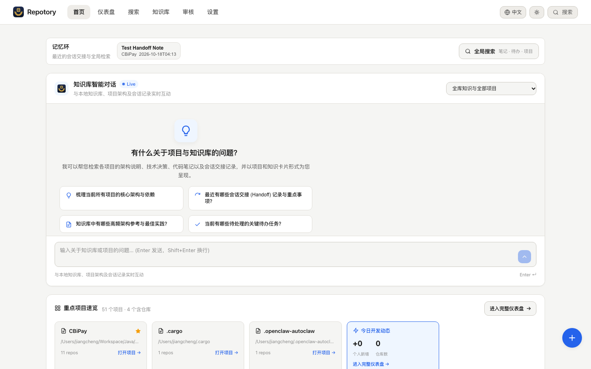
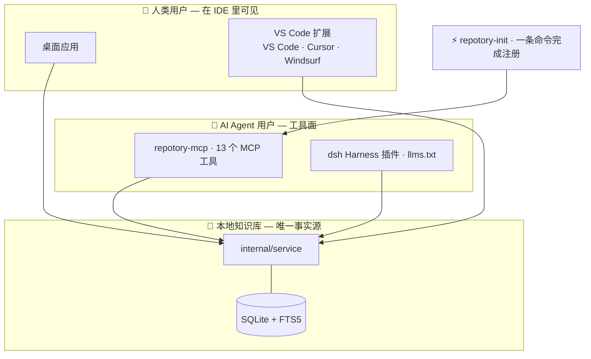
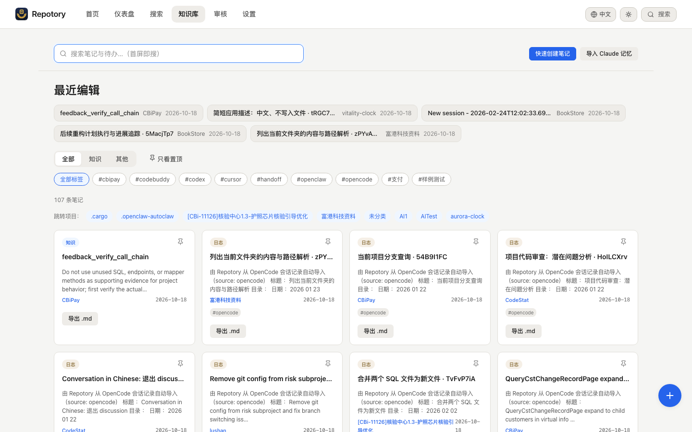
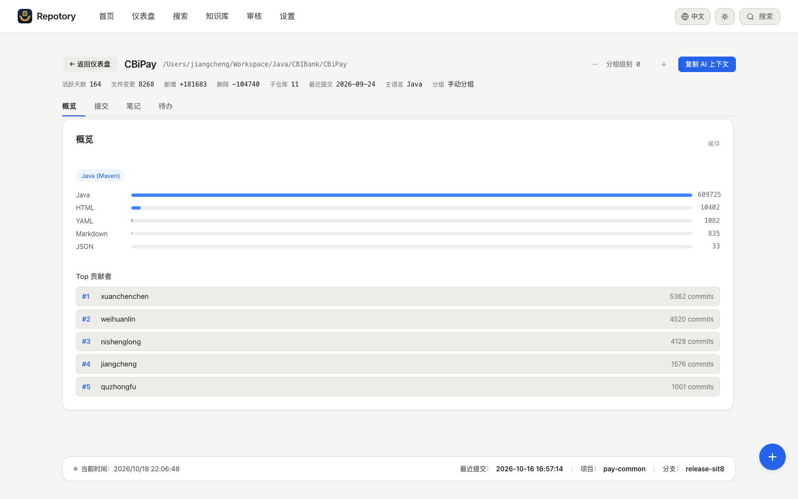

<p align="center">
  
</p>

<h1 align="center">Repotory</h1>

<p align="center">
  <b>面向 AI 编程 Agent 的本地优先记忆层。</b><br/>
  Agent 读代码很聪明，但会话一结束就忘光——为什么这样设计、踩过什么坑、下一步做什么。<br/>
  Repotory 把这些知识留在你的机器上：可搜索、有版本、有备份，<br/>
  并让<i>任何</i>一个 Agent 一次工具调用就把它接回去。
</p>

<p align="center">
  <a href="https://github.com/sky-jiangcheng/repotory/releases"></a>
  <a href="https://github.com/sky-jiangcheng/repotory/actions/workflows/release.yml"></a>
  <a href="https://github.com/sky-jiangcheng/repotory/actions/workflows/ci.yml"></a>
  <a href="https://github.com/sky-jiangcheng/repotory/actions/workflows/install-smoke.yml"></a>
  
  
  <a href="./LICENSE"></a>
  
</p>

<p align="center">
  <a href="README.md">English</a> | 简体中文 · <a href="https://sky-jiangcheng.github.io/repotory/zh/">中文文档</a>
</p>

<p align="center">
  
</p>

<p align="center">
  <sub>单文件 Wails v2 桌面应用（Go + React，内嵌 SQLite，零 CGO），支持 macOS / Windows / Linux；<br/>
  独立分发的 MCP 服务器让任何 AI Agent 读取同一个本地数据库。</sub>
</p>

---

## 为什么是 Repotory？

- **记忆在 Agent 之外，而不是之内。** Claude Code 写下交接，Cursor 明天就能读。知识不会被锁在某一个工具的私有记忆格式里。
- **本地优先，无云、无账号。** 一个 SQLite 文件躺在你的磁盘上，完全离线可用；除非你显式配置了外发端点，否则任何东西都不离开本机。
- **知识靠人把关。** LLM Wiki 编译器产出的页面一律是**待审**状态；你在审核队列里批准、拒绝或合并。机器写的知识不可能绕过你进入检索。

## 目录

- [闭环](#闭环)
- [截图](#截图)
- [功能](#功能)
- [快速开始](#快速开始)
- [VS Code 扩展（预览）](#vs-code-扩展预览)
- [从源码构建](#从源码构建)
- [项目结构](#项目结构)
- [命名分层](#命名分层)
- [文档](#文档)
- [贡献](#贡献)
- [许可证](#许可证)

## 闭环

整个产品就是一个闭环——会话边界上的三次工具调用，之后每一个接手的 Agent 都复用上一个留下的东西：


那条虚线是重点：交接存在本地 SQLite 里，不在任何 Agent 的私有记忆中，所以闭环能跨 Agent 合上——Claude Code 写的交接，Cursor 直接读。

两条路径汇于同一个本地知识库——人这一侧（桌面应用、VS Code 扩展）、Agent 那一侧（MCP 工具、llms.txt），下面同一套 service 层，`repotory-init` 一条命令把 Agent 侧接好：



> **为什么需要 Repotory？** 编程 Agent 不保留*你跨多个仓库积累的判断*：为什么这样设计、上次踩了什么坑、下一个 todo 是什么。每个 Agent 各有一套私有记忆格式，换工具等于从零开始。Repotory 把它们全部沉淀进一个本地、可搜索的记忆层，任何 Agent 都能读写——`repotory_context` 在会话开始时注入，`repotory_handoff` 在会话结束时捕获，其间按需检索。
> 关于产品定位优先级、功能分级与范围冻结，见 [ADR-0006](docs/adr/0006-scope-freeze.md) 与[定位简报](docs/positioning-brief.md)（仅中文）。

## 截图

<table>
  <tr>
    <td width="50%"></td>
    <td width="50%"></td>
  </tr>
  <tr>
    <td align="center"><sub><b>知识库</b>——导入笔记、交接记录与你自己的写作，一条可搜索的流</sub></td>
    <td align="center"><sub><b>项目详情</b>——每个仓库的挖掘结果、动态与积累的知识</sub></td>
  </tr>
</table>

## 功能

> 分级图例：**Core**（完成「发现 → 理解 → 记录 → 检索 → AI」闭环）| **Support**（让闭环可读可感）| **Experimental**（保留但不扩展）| **Paused**（不再投入）。见 [ADR-0006](docs/adr/0006-scope-freeze.md)。

### 知识库（Core）

| 功能 | 说明 |
|------|------|
| Markdown 笔记 | 标题 / 标签 / 分类（knowledge · journal · ideas · other）/ 置顶 / 跨项目移动；草稿自动保存 |
| 块编辑器 | 输入 `/` 打开块面板，插入 callout、标签页、折叠块、代码、Mermaid、数学、表格……拖拽排序；输出仍是纯 Markdown（**Experimental**：复杂块暂停扩展） |
| 富文本渲染 | highlight.js 代码高亮、Mermaid 图表、KaTeX 数学、GFM callout 与任务列表 |
| FTS5 全文搜索 | trigram + bm25 相关度排序、片段高亮，覆盖笔记与待办；短 CJK 查询自动回退 LIKE |
| 版本历史 | 每次保存自动快照；任意版本与当前版本行级 diff，一键恢复 |
| 全局搜索 | ⌘/Ctrl+K 命令面板 + 独立搜索页（联邦检索：仓库 / 笔记 / 待办） |

### AI 就绪接口（Core）

| 通道 | 说明 |
|------|------|
| MCP 服务器 | `repotory-mcp` stdio 服务器，13 个工具（仓库扫描 + 上下文注入 + 会话交接 + 笔记 CRUD + 项目查询 + 搜索 + 两项自检）；可接入 Claude Code / Cursor 等（AI 执行动作的唯一通道） |
| `repotory_scan` | 一次冷启动：播种默认扫描根并同步扫描，发现本地 Git 仓库。纯 MCP 安装（无桌面应用）也能把知识库从零建起来 |
| `repotory_context` | 会话开始一次调用拉齐项目全貌：技术栈 / README 摘要 / 依赖 / 最近提交 / 未完成待办 / 高相关笔记（交接笔记优先）——替代 3-4 次链式查询 |
| `repotory_handoff` | 会话结束时结构化交接：summary / changes / decisions / gotchas / next_steps 渲染统一模板并落库；下一个会话（任何 Agent）自动读到 |
| llms.txt | `GenerateLLMsTxt` 输出面向 LLM 的知识库 Markdown 总览 |
| 笔记导出 | 任意笔记导出为带 YAML frontmatter 的 `.md` |
| 知识源导入 | 把其它 Agent 的记忆带进来：**Claude**、**Codex**、**OpenCode**、**CodeBuddy**（含 CodeBuddy 记忆）、**Cursor**、**OpenClaw**、**Hermes**——记忆类源按情况随启动自动导入；会话转录类源一律**显式手动触发**（白名单限定）。幂等 upsert：重跑是更新，不是堆叠 |
| 会话自动捕获（M1） | 按需抓取项目最近一次 Claude Code 会话转录成交接笔记；`repotory-capture` CLI 承载 B 端 SessionEnd hook 自动化。**默认关**（`claude_session_capture`），隐私门控 |
| 便携记忆导出 | `ExportMemoryJSON` 以 [Open Memory Protocol](https://github.com/SMJAI/open-memory-protocol) 风格导出知识库（临时口径；OMP 尚未 1.0） |
| 数据完整性自检 | `repotory_integrity` 六项只读检查：FTS 索引漂移、孤儿行、schema 形状与版本戳、扫描覆盖、知识缓存新鲜度、版本快照孤儿。索引漂移会让搜索**静默漏结果**且无其它机制能发现——这是唯一的检测手段 |

### 知识图谱 & LLM Wiki（Support——人把关）

受控关系词表组织的编译页面，加上一道「人是闸门」的审核队列：

| 功能 | 说明 |
|------|------|
| LLM Wiki 编译器 | 把笔记编译成结构化 wiki 页面（entity / concept / synthesis …），一律为**待审**草稿；编译器永不改已批准页（[ADR-0015](docs/adr/0015-w3-minimal-compile-loop.md)） |
| 审核队列 | 批准 / 拒绝 / 删除待审页；被拒页保留为墓碑（`reject ≠ delete`） |
| 页面版本 | 每次页面变更由数据库触发器快照进 append-only 的 `page_versions` 表；行级 diff 与恢复（[ADR-0021](docs/adr/0021-temporal-graph-page-versions.md)） |
| 合并建议 | 结构候选发现（共享来源 / slug 词形 / 标题重叠 / 已互链——至少两个独立信号）；模型只加第二意见，**合并只能由人采纳**；合并留下墓碑并重指向边（[ADR-0019](docs/adr/0019-entity-resolution-merge.md)） |
| 社区摘要 | 在已批准图上跑 Label Propagation，按主题起草 synthesis 页；**opt-in 门**（`wiki_community_summary`），硬预算，外发字节可审计（[ADR-0020](docs/adr/0020-community-synthesis.md)） |
| 图感知取证 | `evidencePages` 沿白名单关系词表 1 跳扩召回 + 纯 Go PPR 重排；**默认关**（`wiki_graph_search`），关闭时零行为回退（[ADR-0018](docs/adr/0018-knowledge-graph-foundation.md)） |
| 语义检索（M3） | 可选的 FTS5 + 向量混合召回（RRF 融合），**向量库可插拔**：本地 **sqlite-vec**（默认，纯 Go/零 CGO）或远端 **Qdrant** / **Weaviate**（不可达自动回退本地）。**默认关**，由 A/B 评估门（`cmd/abeval`）决定是否开启（[ADR-0012](docs/adr/0012-semantic-search.md)、[ADR-0013](docs/adr/0013-vector-database-selection.md)） |

### 内置备份（Core）

本地优先的数据库只躺在一块盘上，离灾难就差一个坏扇区：

| 功能 | 说明 |
|------|------|
| 每日本地快照 | 应用每天第一次打开时用 `VACUUM INTO` 给数据库拍一份快照，落在 `<数据目录>/backups/`；保留 14 份、权限 0600，**默认开、零配置**（[ADR-0025](docs/adr/0025-backup-recovery.md)） |
| 恢复 = 拷回一个文件 | 快照是完整独立的 SQLite 文件，恢复就是换文件；已在真库上端到端演练 |
| 异地副本（opt-in，规划中） | Litestream 式 WAL 流式归档或快照上传 S3 兼容存储——ADR-0025 L2 只定型未实现。红线：活库永不放进云盘同步文件夹 |

### 仓库挖掘（Core）

项目详情页自动抽取：README 摘要、技术栈清单（识别 20+ 清单格式）、语言 LOC 占比、依赖列表（npm / go.mod 含 block require / cargo）、主要贡献者、活跃统计、最近提交流；结果缓存进 `repo_meta` 避免重复扫描。

### 仪表盘与统计（Support）

> 首页是融合工作台（[ADR-0024](docs/adr/0024-home-workbench-merge-search-page.md)）：助手、记忆环、重点项目与今日动态一页聚合；`/search` 是独立页面；导航顺序 首页 → 仪表盘 → 搜索 → 知识库 → 审核 → 设置。

| 功能 | 说明 |
|------|------|
| 自动发现仓库 | 配置扫描根递归发现全部 Git 仓库；默认值随平台自适应 |
| 可视化仪表盘 | 每日目标进度环、项目卡片、趋势折线（7 / 30 天 / 全部）、提交热力图 |
| 仓库收藏 | 收藏仓库显示完整统计卡片；未收藏只显示名字，按需跟进 |
| 按需历史回填 | 收藏卡片上的「回填历史」抓取该仓库最近 365 天的每日统计 |
| 智能项目分组 | 自动识别 monorepo 与单仓库；手动拆分/合并单事务执行（笔记与待办随项目移动） |
| 工作日检查 | 自定义每日代码目标，未达标提醒 |
| 状态栏 | 实时展示最近一次提交（仓库 / 分支 / 时间，30s 缓存） |
| 主题切换 | 亮色 / 暗色 / 跟随系统，重启后保留 |

### 其它

| 功能 | 说明 |
|------|------|
| i18n | 中 / 英一键切换（react-i18next，zh-CN + en） |
| 单文件跨平台 | 单个 Go 二进制，无运行时依赖 |
| 设计上离线 | 无账号、无遥测；只有你显式配置端点时才产生外发 |

## 快速开始

### 安装

从 [Releases](https://github.com/sky-jiangcheng/repotory/releases) 获取对应平台的最新构建。

**方式 1：直接下载**

| 平台 | 资产 |
|------|------|
| macOS | `repotory-darwin-arm64.dmg` / `repotory-darwin-amd64.dmg` |
| Linux | `repotory-linux-amd64.tar.gz` |
| Windows | `repotory-windows-amd64.zip` |

**方式 2：一行安装脚本**（桌面应用 + `repotory-mcp` 一起装）

| 平台 | 命令 | 安装位置 |
|------|------|----------|
| macOS | `curl -fsSL https://raw.githubusercontent.com/sky-jiangcheng/repotory/master/scripts/install.sh \| bash` | `/Applications/Repotory.app` + `/usr/local/bin/repotory-mcp` |
| Linux | 同上 | `/usr/local/bin/repotory` + `/usr/local/bin/repotory-mcp` |
| Windows | `iwr -useb https://raw.githubusercontent.com/sky-jiangcheng/repotory/master/scripts/install.ps1 \| iex` | `%LOCALAPPDATA%\Repotory`（自动加入用户 PATH） |

**方式 3：包管理器**

```bash
# macOS（桌面应用）
brew tap sky-jiangcheng/repo && brew install --cask sky-jiangcheng/repo/repotory
# Windows（桌面应用）
scoop bucket add repo https://github.com/sky-jiangcheng/scoop-repo && scoop install repo/repotory
```

清单文件在 [`packaging/`](packaging/README.md)——版本取自 `wails.json`，`sha256` 取自真实发布资产（校验和不匹配安装必须失败，这是设计）。

启动即开桌面窗口（Wails 应用，无需浏览器）：

1. 首次启动自动播种默认扫描根（macOS/Linux 为 HOME；Windows 为非系统盘）
2. 在仪表盘点 **Rescan** 发现仓库——此时**知识库已经可用**：写笔记、搜笔记、交给 AI
3. （可选，只影响仪表盘统计）收藏你在意的仓库 → **回填历史** 抓取 365 天统计

> **只要 AI 那一侧？** 不需要桌面应用：安装 `repotory-mcp`，让 Agent 调一次 `repotory_scan` 把知识库从零建起来。

更多见[快速上手](docs/getting-started.md)。

> **CLI 工具**（可选，进阶）：`repotory vector-init` —— 引导式配置向量库（默认本地 / 远端 Qdrant/Weaviate）与 embedding 提供方；`repotory-capture` —— Claude Code SessionEnd hook 的目标，自动捕获已关闭的会话；`go run ./cmd/abeval -cases queries.jsonl` —— 决定语义检索是否够格开启的 A/B 门。全部读同一个本地数据库；见 [ADR-0013](docs/adr/0013-vector-database-selection.md)。

### 配置 AI 执行接口（`repotory-mcp`）

AI 客户端连接独立分发的 `repotory-mcp`（MCP stdio 服务器）——**不需要桌面应用**，读同一个本地数据库。上面的安装脚本会一并装好；也可单独安装：

| 方式 | 平台 | 命令 |
|------|------|------|
| 手动（无前置） | 全平台 | 从 [Releases](https://github.com/sky-jiangcheng/repotory/releases) 下载 `repotory-mcp-<target>.tar.gz` / `.zip` |
| Homebrew | macOS | `brew tap sky-jiangcheng/repo && brew install --cask sky-jiangcheng/repo/repotory-mcp` |
| Homebrew | Linux | `brew tap sky-jiangcheng/repo && brew install sky-jiangcheng/repo/repotory-mcp` |
| Scoop | Windows | `scoop bucket add repo https://github.com/sky-jiangcheng/scoop-repo && scoop install repo/repotory-mcp` |

然后注册给 AI 客户端——一条命令覆盖 Claude Code / Cursor / VS Code / Windsurf（[ADR-0009](docs/adr/0009-ide-presence.md) 第一步，幂等）：

```bash
node scripts/repotory-init/index.mjs --with-hook
```

或只注册 Claude Code：

```bash
claude mcp add repotory -- "$(which repotory-mcp)"
```

#### 30 秒看到效果

注册完成后，首次使用还差一步：

> **首次使用**（建立知识库，无需桌面应用）：
> Agent 调 `repotory_scan()`——播种默认扫描根并扫描，一次返回你的本地仓库列表。

之后每个工作会话都按这个节奏走：

> **会话开始**（新 Agent 接手项目）：
> 「继续做 auth 项目。」
>
> Agent 调 `repotory_context({ project_name: "auth" })`——技术栈、待办、上次会话的交接笔记一次拿齐，直接开工。

> **会话结束**（知识不蒸发）：
> Agent 调 `repotory_handoff({ project_id: 1, summary: "完成 OAuth 迁移", gotchas: ["生产 cookie key 需要轮换"], next_steps: ["跑回归套件"] })`——下一个会话（哪怕换 Cursor）自动从这里继续。

其间任何时候都可以直接问：

> 「我有哪些本地项目？关于 auth 我记过什么？」

Agent 会链式调用 `repotory_projects_list` → `repotory_notes_search` → `repotory_notes_read`；新结论用 `repotory_notes_create` 写回。完整工具清单与工作流见 [SKILL.md](SKILL.md)。

### 数据目录

配置与数据库位于每用户的应用数据目录（升级时 schema 自动迁移）：

- **macOS**：`~/Library/Application Support/repotory/repotory.db`
- **Windows**：`%APPDATA%/repotory/repotory.db`
- **Linux**：`~/.config/repotory/repotory.db`

每日快照就在旁边的 `backups/` 里。日志路径见[故障排查](docs/troubleshooting.md)。

## VS Code 扩展（预览）

扩展（VS Code / Cursor / Windsurf——一个 VSIX 通吃三者）目前是**预览**。每次产品发布自动发布到 [Marketplace](https://marketplace.visualstudio.com/items?itemName=sky-jiangcheng.repotory-vscode)（配置了 `VSCE_PAT` secret 后生效）；`.vsix` 也随每个 [Release](https://github.com/sky-jiangcheng/repotory/releases) 附带，可手动安装，也可从源码打包：

```bash
git clone https://github.com/sky-jiangcheng/repotory.git
cd repotory/ide/vscode
npm install
npx @vscode/vsce package --no-dependencies   # → repotory-vscode-2.6.0.vsix
```

然后安装产出的 `.vsix`：

- **界面**：扩展视图 → `⋯` 菜单 → **Install from VSIX…**
- **命令行**：`code --install-extension repotory-vscode-2.6.0.vsix`（分叉编辑器用 `cursor` / `windsurf`）

扩展是瘦客户端：命令通过 stdio 调用 `repotory-mcp`（先装好——brew / scoop / [Releases](https://github.com/sky-jiangcheng/repotory/releases)），所有回答来自与桌面应用相同的 `internal/service` 层。能力细节见 [`ide/vscode/README.md`](ide/vscode/README.md)。

## 从源码构建

前置：**Go 1.26+**、**Node.js 20+**（前端构建）、可选 [Wails CLI](https://wails.io) v2.13+。

```bash
# 前端依赖与构建（web/dist 经 go:embed 打进二进制）
cd web && npm install && npm run build && cd ..

# 桌面应用
go build -ldflags "-s -w" -o repotory .

# MCP 服务器
go build -o repotory-mcp ./cmd/mcp/

# 或使用脚本
./scripts/build.sh
```

开发模式：`wails dev`（前端热重载 + Wails 绑定注入）。浏览器模式开发栈：`bash scripts/dev.sh`（无头 API :18765 + Vite :5173）。

测试与检查：

```bash
go test ./...            # 全量 Go 测试（service/db/knowledge/scanner/diff…）
cd web && npm test       # vitest
cd web && npm run build  # 严格 tsc 检查 + 生产构建
cd web && npm run lint   # eslint
```

## 项目结构

```
main.go                  # Wails 入口：DB 初始化、扫描根播种、窗口与安全头
internal/
  app/                   # Wails 绑定层：每个方法 1-3 行委托给 service
  service/               # 业务核心：扫描管线、统计刷新、项目/笔记/搜索/导出
                          #   （桌面、CLI 与 MCP 共用同一实现）
  domain/                # 跨层共享的行类型
  db/                    # SQLite：schema/迁移 + 按域拆分的查询（projects/notes/…）
  core/git/              # Git 提供方抽象（本地 CLI 实现）
  core/plugin/           # 知识源导入 SPI（源注册、探测、导入运行）
  importers/             # 各来源读取器：claude / codex / opencode / codebuddy / cursor / openclaw / hermes
  graph/                 # 知识图谱用的纯 Go Label Propagation + PPR
  integrity/             # repotory_integrity 背后的只读完整性检查
  stats/ knowledge/      # git log 统计、仓库挖掘
  scanner/ grouper/      # 文件系统扫描、项目分组
  platform/              # OS 差异：数据目录、日志路径、默认扫描根
  version/ diff/         # 单一版本源、笔记行级 diff
cmd/
  mcp/                   # MCP stdio 服务器（AI 执行接口 + agent-score 自检工具）
  server/                # 无头 HTTP API（浏览器模式、CI 冒烟）
web/src/
  api/                   # 类型 + 传输层（Wails/HTTP 双模式）+ endpoints
  hooks/                 # useApiData（缓存）/ useDebouncedCallback / useScanPolling…
  pages/ components/     # 页面与组件（大页面按域拆子目录）
  locales/ styles/       # zh-CN + en；设计系统 CSS
```

架构决策见 [ADR 列表](docs/adr/index.md)，尤其是 [ADR-0005 service 层重构](docs/adr/0005-service-layer.md)；分层与数据流见[架构说明](docs/architecture.md)。前后端契约（Wails 绑定面）见 [API 参考](docs/api/reference.md)。

## 命名分层

品牌名与机器标识是**刻意分开的两层**：展示层为了被记住，标识层为了保持稳定（URL、升级路径、数据迁移与对外契约不跟着品牌措辞走）。

| 层 | 值 | 用途 |
|----|----|------|
| 品牌（展示） | `Repotory` | `productName`、应用内 logo、文档与 UI 文案 |
| 完整展示名 | `Repotory: Local Git Knowledge Base` | 窗口标题、HTML `<title>`、README 标题 |
| 仓库与包标识 | `repotory` | GitHub 仓库名、Go module 名、npm 包名、文档站 URL |
| 对品牌刻意冻结的标识 | `repotory` | 命令/二进制名（`outputfilename`）、用户数据目录、MCP 服务器名 `repotory-mcp` 与工具前缀 `repotory_*` |

为什么冻结：数据目录已经历两次自动迁移（gitboard → gitbuddy → repotory）；`repotory` → `Repotory` 更名时刻意没动它，因为再来一次更名就是第三次数据搬家。MCP 工具名是与 AI 客户端的外部契约——改名会打坏既有配置与白名单。贡献时请不要「顺手统一」这些名字。

## 文档

中文手册与[英文站](https://sky-jiangcheng.github.io/repotory/)互为镜像。仅[定位简报](docs/positioning-brief.md)与[产品评审](docs/product-review/2026-08-27-new-deep-review.md)等研究类文档只出中文。

| 文档 | 内容 |
|------|------|
| [快速上手](docs/getting-started.md) | 安装、首次运行、扫描 |
| [数据与备份](docs/data-management.md) | 备份、迁移机器、重置与卸载 |
| [功能说明](docs/features/knowledge.md) | 知识库 / 仪表盘 / 项目详情 / 设置 / 命令面板 |
| [知识源](docs/plugins/overview.md) | 内置导入器、事件、各来源行为 |
| [AI 集成](docs/features/ai-integration.md) | CLI、MCP、llms.txt |
| [API 参考](docs/api/reference.md) | Wails 绑定面契约 + OpenAPI |
| [架构](docs/architecture.md) | 分层、数据流、关键决策 |
| [故障排查](docs/troubleshooting.md) | FAQ 与日志路径 |
| [SKILL.md](SKILL.md) | 面向 AI Agent 的能力卡 |
| [TODO.md](TODO.md) | 已知问题与路线图 |

[在线文档](https://sky-jiangcheng.github.io/repotory/zh/)（GitHub Pages，master 自动部署）。

## 贡献

开发环境与提交规范见 [CONTRIBUTING.md](CONTRIBUTING.md)。快速开始：

前置：**Go 1.26+**、**Node.js 20+**、Git。

```bash
cd web && npm install && npm run build && cd ..  # 前端构建
go test ./...                                     # Go 测试
cd web && npm test                                # 前端测试
wails dev                                         # 开发模式（可选）
```

架构约定：[docs/architecture.md](docs/architecture.md) 与 [docs/adr/](docs/adr/index.md)。提交遵循 [Conventional Commits](https://www.conventionalcommits.org/)。安全问题走[私下报告通道](SECURITY.md)。

## 许可证

[MIT](LICENSE)
