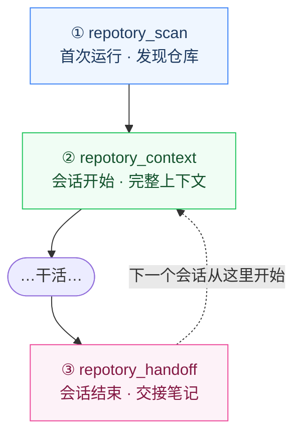

<p align="center">
  
</p>

<h1 align="center">Repotory</h1>

<p align="center">
  <b>面向 AI 编程 Agent 的本地优先记忆层。</b><br/>
  Agent 读代码很聪明，但会话一结束就忘光——为什么这样设计、踩过什么坑、下一步做什么。<br/>
  Repotory 把这些知识留在你的机器上：可搜索、有版本、有备份，<br/>
  并让<i>任何</i>一个 Agent 一次工具调用就把它接回去。
</p>

<p align="center">
  <a href="https://github.com/sky-jiangcheng/repotory/releases"></a>
  <a href="https://github.com/sky-jiangcheng/repotory/actions/workflows/release.yml"></a>
  <a href="https://github.com/sky-jiangcheng/repotory/actions/workflows/ci.yml"></a>
  <a href="https://github.com/sky-jiangcheng/repotory/actions/workflows/install-smoke.yml"></a>
  
  
  <a href="./LICENSE"></a>
  
</p>

<p align="center">
  <a href="README.md">English</a> | 简体中文 · <a href="https://sky-jiangcheng.github.io/repotory/zh/">中文文档</a>
</p>

<p align="center">
  
</p>

<p align="center">
  <sub>单文件 Wails v2 桌面应用（Go + React，内嵌 SQLite，零 CGO），支持 macOS / Windows / Linux；<br/>
  独立分发的 MCP 服务器让任何 AI Agent 读取同一个本地数据库。</sub>
</p>

---

## 为什么是 Repotory？

- **记忆在 Agent 之外，而不是之内。** Claude Code 写下交接，Cursor 明天就能读。知识不会被锁在某一个工具的私有记忆格式里。
- **本地优先，无云、无账号。** 一个 SQLite 文件躺在你的磁盘上，完全离线可用；除非你显式配置了外发端点，否则任何东西都不离开本机。
- **知识靠人把关。** LLM Wiki 编译器产出的页面一律是**待审**状态；你在审核队列里批准、拒绝或合并。机器写的知识不可能绕过你进入检索。

## 快速开始

### 1 — 安装

| 方式 | 命令 / 资产 |
|------|-------------|
| 直接下载 | [Releases](https://github.com/sky-jiangcheng/repotory/releases) — `repotory-darwin-arm64.dmg` / `repotory-linux-amd64.tar.gz` / `repotory-windows-amd64.zip` |
| 一行脚本（macOS / Linux） | `curl -fsSL https://raw.githubusercontent.com/sky-jiangcheng/repotory/master/scripts/install.sh \| bash` —— 应用**和** `repotory-mcp` 一起装 |
| 一行脚本（Windows） | `iwr -useb https://raw.githubusercontent.com/sky-jiangcheng/repotory/master/scripts/install.ps1 \| iex` |
| Homebrew / Scoop | `brew install --cask sky-jiangcheng/repo/repotory` · `scoop install repo/repotory` —— 清单在 [`packaging/`](packaging/README.md)（版本取自 `wails.json`，校验和取自发布资产） |

首次启动自动播种默认扫描根（macOS/Linux 为 HOME；Windows 为非系统盘）。在仪表盘点 **Rescan** 发现仓库——此时**知识库已经可用**：写笔记、搜笔记、交给 AI。可选：收藏你在意的仓库 → **回填历史** 抓取 365 天统计。完整上手见[快速上手](docs/getting-started.md)。

### 2 — 接上你的 Agent

`repotory-mcp` 是独立分发的 MCP stdio 服务器，读同一个本地数据库——**不需要桌面应用**。一条幂等命令把它注册给 Claude Code / Cursor / VS Code / Windsurf（[ADR-0009](docs/adr/0009-ide-presence.md)）：

```bash
node scripts/repotory-init/index.mjs --with-hook
# 只注册 Claude Code：
claude mcp add repotory -- "$(which repotory-mcp)"
```

### 3 — 跑起来

```text
首次运行      repotory_scan()                                  发现仓库，从零建知识库
会话开始      repotory_context({ project_name: "auth" })       技术栈、待办、上次交接——一次拿齐
会话结束      repotory_handoff({ summary, gotchas, next_steps }) 下一个 Agent 从这里继续
```

其间任何时候都可以直接问——*「关于 auth 我记过什么？」*——Agent 会链式调用 `repotory_projects_list` → `repotory_notes_search` → `repotory_notes_read`，新结论用 `repotory_notes_create` 写回。完整工具清单与工作流见 [SKILL.md](SKILL.md)。

所有数据都在一个每用户的 SQLite 文件里——`~/Library/Application Support/repotory/`（macOS）· `%APPDATA%\repotory\`（Windows）· `~/.config/repotory/`（Linux）——旁边 `backups/` 是每日 `VACUUM INTO` 快照（留 14 份，0600；恢复 = 拷回一个文件）。详见[数据与备份](docs/data-management.md)。

> **CLI 工具**（可选，进阶）：`go run ./cmd/vector-init` —— 向量库（本地 / Qdrant / Weaviate）与 embedding 提供方配置；`repotory-capture` —— Claude Code SessionEnd hook 的目标；`go run ./cmd/abeval` —— 决定语义检索是否够格开启的 A/B 门。全部读同一个数据库——[ADR-0013](docs/adr/0013-vector-database-selection.md)。

## 闭环

会话边界上的三次工具调用；之后每一个接手的 Agent 都复用上一个留下的东西：



那条虚线是重点：交接存在本地 SQLite 里，不在任何 Agent 的私有记忆中，所以闭环能**跨 Agent** 合上——Claude Code 写的交接，Cursor 直接读。人的一侧、Agent 的一侧与本地核心如何拼装（以及 `repotory-init` 的位置）：见[架构说明](docs/architecture.md)。

## 截图

<table>
  <tr>
    <td width="50%"></td>
    <td width="50%"></td>
  </tr>
  <tr>
    <td align="center"><sub><b>知识库</b>——导入笔记、交接记录与你自己的写作，一条可搜索的流</sub></td>
    <td align="center"><sub><b>项目详情</b>——每个仓库的挖掘结果、动态与积累的知识</sub></td>
  </tr>
</table>

## 功能

> 完整功能表（含层级图例与 ADR 链接）：[docs/features-overview.md](docs/features-overview.md)。层级模型：**Core**（补完 发现 → 理解 → 沉淀 → 检索 → 交给 AI 闭环）· **Support**（让闭环可读）· **Experimental**（保留不再扩张）· **Paused**（不再投入）——见 [ADR-0006](docs/adr/0006-scope-freeze.md)。

- **知识库（Core）** —— Markdown 笔记 + `/` 块编辑器、FTS5 三元组搜索、逐次保存的版本历史与行级 diff、全局 ⌘/Ctrl+K 搜索
- **AI 就绪接口（Core）** —— `repotory-mcp`（13 个 MCP 工具）、单次调用 `repotory_context` / `repotory_handoff`、llms.txt、8 个内置记忆导入源（Claude / Codex / OpenCode / CodeBuddy / Cursor / OpenClaw / Hermes…）、OMP 风格导出、数据完整性审计（`repotory_integrity`）
- **知识图谱 & LLM Wiki（Support，人把关）** —— 笔记编译为**待审** wiki 页；审核队列（批准 / 拒绝 / 合并，墓碑语义）；页面版本；合并建议；社区摘要；图感知取证；混合语义检索 + 可插拔向量库（默认 sqlite-vec，远程 Qdrant / Weaviate）——所有 LLM 路径都是 opt-in 门，默认关
- **内置备份（Core）** —— 每日 `VACUUM INTO` 快照（默认开，留 14 份，0600）；恢复 = 拷回一个文件；异机推送见 [ADR-0025](docs/adr/0025-backup-recovery.md) L2
- **仓库挖掘（Core）** —— README 摘要、技术栈（20+ 清单格式）、语言占比、依赖、贡献者、活跃度、提交流——按仓库缓存
- **仪表盘与统计（Support）** —— 目标环、趋势、热力图、收藏、智能分组、工作日提醒、实时状态栏、主题切换

## VS Code 扩展（预览）

一个 VSIX 通吃 VS Code / Cursor / Windsurf。扩展是瘦客户端：命令通过 stdio 调用 `repotory-mcp`（先装好），所有回答来自与桌面应用相同的 `internal/service` 层。随每个版本发布——从 [Marketplace](https://marketplace.visualstudio.com/items?itemName=sky-jiangcheng.repotory-vscode) 或每个 [Release](https://github.com/sky-jiangcheng/repotory/releases) 附带的 `.vsix` 获取——也可从源码打包：

```bash
cd ide/vscode && npm install && npx @vscode/vsce package --no-dependencies
code --install-extension repotory-vscode-*.vsix   # 分叉编辑器：cursor / windsurf
```

细节见 [`ide/vscode/README.md`](ide/vscode/README.md)。

## 从源码构建

前置：**Go 1.26+**、**Node.js 20+**（前端构建）、可选 [Wails CLI](https://wails.io) v2.13+。

```bash
cd web && npm install && npm run build && cd ..   # web/dist 经 go:embed 打进二进制
go build -ldflags "-s -w" -o repotory .           # 桌面应用
go build -o repotory-mcp ./cmd/mcp/               # MCP 服务器
./scripts/build.sh                                # 或使用脚本
```

开发模式：`wails dev`（前端热重载 + Wails 绑定注入）。浏览器模式开发栈：`bash scripts/dev.sh`（无头 API :18765 + Vite :5173）。

```bash
go test ./...            # 全量 Go 测试（service/db/knowledge/scanner/diff…）
cd web && npm test       # vitest
cd web && npm run build  # 严格 tsc 检查 + 生产构建
cd web && npm run lint   # eslint
```

## 项目结构

```
main.go            # Wails 入口：DB 初始化、扫描根播种、窗口与安全头
internal/          # app（绑定层）· service（业务核心，桌面/CLI/MCP 共用）· db · domain
                   # core/git · core/plugin · importers · graph · integrity · stats · knowledge
                   # scanner · grouper · platform · version · diff
cmd/mcp/           # MCP stdio 服务器（AI 执行接口 + agent-score 自检工具）
cmd/server/        # 无头 HTTP API（浏览器模式、CI 冒烟）
web/src/           # React 19 + TypeScript：api · hooks · pages · components · locales · styles
```

分层与数据流见[架构说明](docs/architecture.md)；决策见 [ADR 列表](docs/adr/index.md)，尤其是 [ADR-0005 service 层重构](docs/adr/0005-service-layer.md)；前后端契约见 [API 参考](docs/api/reference.md)。

## 命名分层

品牌名与机器标识是**刻意分开的两层**——URL、升级路径、数据迁移与对外契约不跟着品牌措辞走：

| 层 | 值 | 用途 |
|----|----|------|
| 品牌（展示） | `Repotory` | `productName`、应用内 logo、文档与 UI 文案 |
| 仓库与包标识 | `repotory` | GitHub 仓库名、Go module 名、npm 包名、文档站 URL |
| 对品牌刻意冻结的标识 | `repotory` | 二进制名、用户数据目录、MCP 服务器 `repotory-mcp`、工具前缀 `repotory_*` |

数据目录已经历两次自动迁移（gitboard → gitbuddy → repotory），MCP 工具名是与 AI 客户端的外部契约——贡献时请不要「顺手统一」这些名字。

## 文档

中文手册与[英文站](https://sky-jiangcheng.github.io/repotory/)互为镜像。仅[定位简报](docs/positioning-brief.md)与[产品评审](docs/product-review/2026-08-27-new-deep-review.md)等研究类文档只出中文。

| 文档 | 内容 |
|------|------|
| [功能总览](docs/features-overview.md) | 全量功能表：每个能力、所属层级与背后的 ADR |
| [快速上手](docs/getting-started.md) | 安装、首次运行、扫描 |
| [数据与备份](docs/data-management.md) | 备份、迁移机器、重置与卸载 |
| [功能说明](docs/features/knowledge.md) | 知识库 / 仪表盘 / 项目详情 / 设置 / 命令面板 |
| [知识源](docs/plugins/overview.md) | 内置导入器、事件、各来源行为 |
| [AI 集成](docs/features/ai-integration.md) | CLI、MCP、llms.txt |
| [API 参考](docs/api/reference.md) | Wails 绑定面契约 + OpenAPI |
| [架构](docs/architecture.md) | 分层、数据流、关键决策 |
| [故障排查](docs/troubleshooting.md) | FAQ 与日志路径 |
| [SKILL.md](SKILL.md) | 面向 AI Agent 的能力卡 |
| [TODO.md](TODO.md) | 已知问题与路线图 |

[在线文档](https://sky-jiangcheng.github.io/repotory/zh/)（GitHub Pages，master 自动部署）。

## 贡献

开发环境与提交规范见 [CONTRIBUTING.md](CONTRIBUTING.md)。快速开始：

```bash
cd web && npm install && npm run build && cd ..  # 前端构建
go test ./...                                     # Go 测试
cd web && npm test                                # 前端测试
wails dev                                         # 开发模式（可选）
```

架构约定：[docs/architecture.md](docs/architecture.md) 与 [docs/adr/](docs/adr/index.md)。提交遵循 [Conventional Commits](https://www.conventionalcommits.org/)。安全问题走[私下报告通道](SECURITY.md)。

## 许可证

[MIT](LICENSE) © 2026-present [sky-jiangcheng](https://github.com/sky-jiangcheng) 及 Repotory 贡献者

Repotory 以 MIT 许可证发布——个人与商业使用永久免费、无附加条件。许可证覆盖的是代码；`Repotory` 名称与 logo 仍为项目商标。
