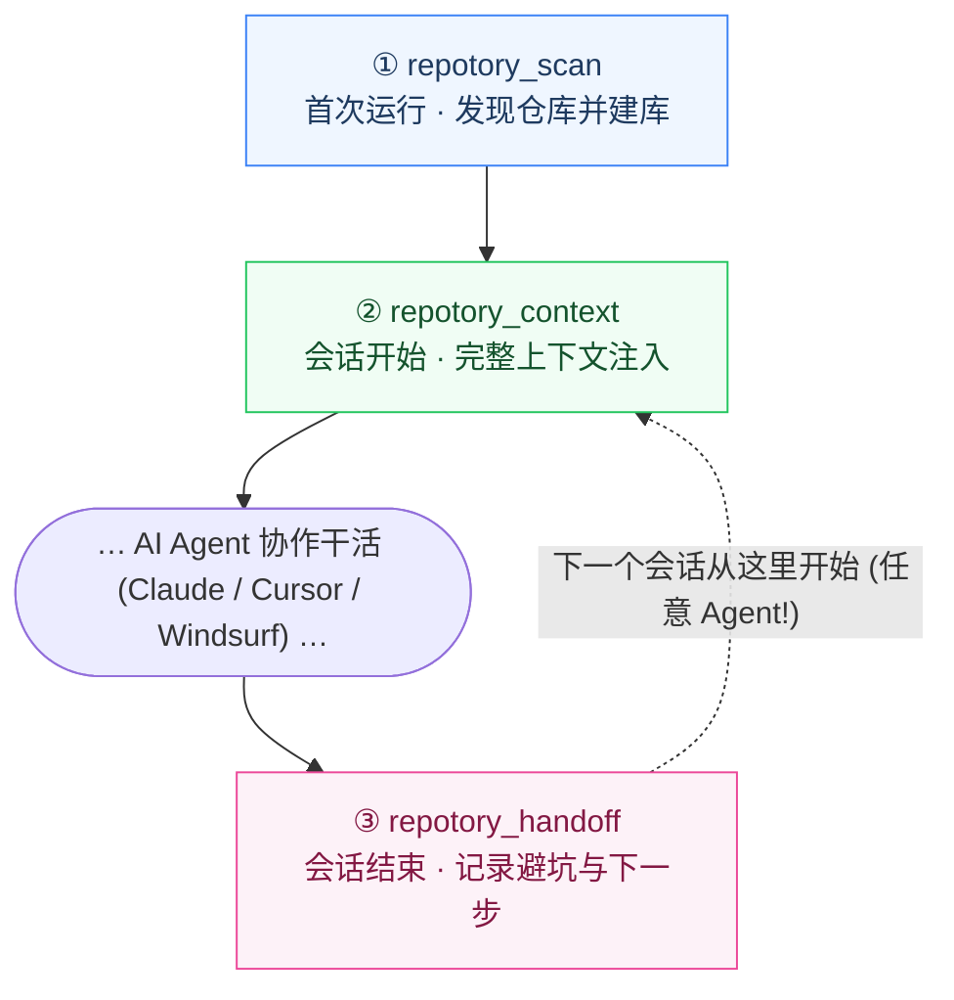

<p align="center">
  <a href="https://github.com/sky-jiangcheng/repotory"></a>
</p>

<h1 align="center">Repotory</h1>

<p align="center">
  <b>面向 AI 编程 Agent 的本地优先记忆层。</b><br/>
  告别 Agent「会话失忆症」。Agent 读代码很聪明，但会话一结束就忘光——为什么这样设计、踩过什么坑、下一步做什么。<br/>
  Repotory 把这些项目知识留在你的本地 SQLite 中：可搜索、有版本、有备份，<br/>
  并让<i>任何</i>一个 Agent 一次工具调用就能无缝接回上下文。
</p>

<p align="center">
  <a href="https://github.com/sky-jiangcheng/repotory/releases"></a>
  <a href="https://github.com/sky-jiangcheng/repotory/actions/workflows/ci.yml"></a>
  <a href="https://github.com/sky-jiangcheng/repotory/actions/workflows/install-smoke.yml"></a>
  
  
  
  <a href="./LICENSE"></a>
</p>

<p align="center">
  <a href="README.md">English</a> | 简体中文 · <a href="https://sky-jiangcheng.github.io/repotory/zh/">中文文档</a>
</p>

---

## 🎯 为什么是 Repotory？

AI 编程正在重构开发模式，但目前的 Agent 普遍存在**会话孤岛**与**记忆断层**。Repotory 在本地提供了最关键的记忆拼图：

| 现状痛点 | Repotory 的解法 |
| :--- | :--- |
| 🔄 **Agent 失忆与孤岛**：Claude Code 写的交接，Cursor 明天读不到。知识被锁死在各工具私有格式里。 | **跨 Agent 共享记忆**：统一本地 SQLite 数据库，Claude Code、Cursor、Windsurf 通过标准 MCP 协议读写同一份记忆。 |
| 💸 **Token 浪费与上下文挤爆**：每次开启新会话都要消耗几千 Token 重复灌输项目背景、架构设计和历史踩坑。 | **一键注入上下文 (`repotory_context`)**：单次工具调用立即注入项目技术栈、避坑指南、当前待办与最新交接。 |
| 🔒 **云端隐私与代码泄露风险**：把核心代码、架构思考和未公开项目上传到第三方云知识库存在泄露隐患。 | **100% 本地优先 & 零 CGO**：完全离线运行在你的本地磁盘上。除非显式配置外发端点，任何数据绝不离开机器。 |
| 🛡️ **AI 幻觉污染知识库**：自主 Agent 悄悄在后台生成错误笔记并污染未来检索。 | **人把关的审查队列**：LLM 编译的 Wiki 知识一律先作为*待审草稿*。你在审核队列中确认或合并后方可入库检索。 |

---

## 📦 产物生态全景

Repotory 不仅是一个应用，而是一套模块化的本地项目知识套件。根据你的工作流自由组合：

| 产物 | 形态 | 核心作用 & 适用场景 | 快速接入 |
| :--- | :--- | :--- | :--- |
| **`repotory-mcp`** | 🤖 独立 MCP 服务器 | **Agent 记忆引擎核心**。通过 stdio 运行。为 Claude Code、Cursor、Windsurf 等提供标准工具接口，**无需打开桌面应用即可独立使用**。 | `node scripts/repotory-init/index.mjs` |
| **Repotory 桌面端** | 🖥️ 桌面应用 | **可视化工作台与审核中心**。单文件原生跨平台桌面应用（Wails v2 + React 19），提供笔记浏览、待办看板、LLM Wiki 审核队列与仓库指标。 | [Releases](https://github.com/sky-jiangcheng/repotory/releases) · `brew` · `scoop` |
| **IDE 扩展插件** | 🧩 VS Code & JetBrains | **编辑器内就地检索**。在 VS Code、Cursor、Windsurf 侧边栏及 IntelliJ 系列 IDE 工具窗中直接搜索笔记、待办与交接记录。 | [VS Code 商店](https://marketplace.visualstudio.com/items?itemName=sky-jiangcheng.repotory-vscode) · JetBrains 插件 |
| **CLI 自动化与守护** | ⚡ 终端工具与服务 | **自动交接钩子与无头服务**。包含 `repotory-capture`（会话结束自动交接 Hook）、`repotory-server`（无头 HTTP API）、向量配置与数据审计工具。 | 随安装脚本自动下发 |

---

## 🚀 快速开始

### 方式 A — 接入你的 AI Agent（最推荐，极速免 GUI）

`repotory-mcp` 是独立分发的 stdio 服务器，直接读写本地数据库。一条命令自动注册到所有支持的客户端：

```bash
# 1. 下载 / 安装 repotory-mcp（macOS / Linux）
curl -fsSL https://raw.githubusercontent.com/sky-jiangcheng/repotory/master/scripts/install.sh | bash

# 2. 一键注册到已安装的 Agent (Claude Code / Cursor / Windsurf / VS Code) 并启用 SessionEnd 钩子
node scripts/repotory-init/index.mjs --with-hook

# 或仅为 Claude Code 单独添加：
claude mcp add repotory -- "$(which repotory-mcp)"
```

### 方式 B — 安装桌面端（可视化工作台）

喜欢图形化工作台、Markdown 块编辑器和人机审核队列？

| 方式 | 命令 / 资产 |
| :--- | :--- |
| **直接下载** | [GitHub Releases](https://github.com/sky-jiangcheng/repotory/releases) — `repotory-darwin-arm64.dmg` / `repotory-linux-amd64.tar.gz` / `repotory-windows-amd64.zip` |
| **Homebrew (macOS)** | `brew install --cask sky-jiangcheng/repo/repotory` |
| **Scoop (Windows)** | `scoop install repo/repotory` |
| **一行脚本 (Windows)** | `iwr -useb https://raw.githubusercontent.com/sky-jiangcheng/repotory/master/scripts/install.ps1 \| iex` |

首次启动自动播种扫描根目录（macOS/Linux 为 HOME；Windows 为非系统盘）。在仪表盘点击 **重新扫描** 即可立即可用。详见[快速上手指南](docs/getting-started.md)。

---

## 🔄 跨 Agent 记忆闭环

在会话边界通过三次工具调用完成交接，让后续每一个接手的 Agent 都能复用前人留下的经验：



```text
会话开始  repotory_context({ project_name: "auth" })          # 技术栈、待办、避坑指南、上次交接
干活期间  repotory_notes_search({ query: "jwt expiry" })      # 检索已验证的项目知识
会话结束  repotory_handoff({ summary, gotchas, next_steps })  # 沉淀交接笔记，留给明天的 Agent
```

那条虚线是核心所在：交接记录存储在本地 SQLite 中，不属于任何特定 Agent 的私有环境。**Claude Code 写的交接，Cursor 明天直接接力。**

---

## ✨ 核心特性

> 完整功能表（含层级分类与 ADR 链接）见 [docs/features-overview.md](docs/features-overview.md)。

- **知识库（Core）** —— Markdown 笔记 + `/` 块编辑器、FTS5 全文搜索、逐次保存的版本历史与行级 diff、全局 ⌘/Ctrl+K 搜索。
- **AI 就绪接口（Core）** —— `repotory-mcp`（18 个 MCP 工具）、单调用注入 `repotory_context` / `repotory_handoff`、llms.txt、8 个内置 Agent 记忆导入源（Claude / Codex / OpenCode / CodeBuddy / Cursor / OpenClaw / Hermes 等）、数据完整性审计（`repotory_integrity`）。
- **知识图谱 & LLM Wiki（Support，人把关）** —— 笔记自动编译为**待审** Wiki 页；审核队列（批准 / 拒绝 / 合并，墓碑语义）；页面版本与合并建议；混合语义检索 + 可插拔向量库（默认 sqlite-vec，支持远程 Qdrant / Weaviate）——LLM 编译流程全面受控。
- **内置安全备份（Core）** —— 每日 `VACUUM INTO` 自动快照（默认开启，保留 14 份，0600 权限）；恢复仅需拷回单个文件。
- **仓库自动挖掘（Core）** —— README 摘要、技术栈识别（20+ 清单格式）、语言分布、依赖关系、贡献者、活跃度趋势。
- **仪表盘与统计（Support）** —— 目标环、活跃趋势、Git 热力图、项目星标收藏、智能分组与明暗主题切换。

---

## 🧩 IDE 插件支持

### VS Code / Cursor / Windsurf 扩展

一个通用的 VSIX 瘦客户端：通过 stdio 与 `repotory-mcp` 通信，在侧边栏直接查看项目知识与交接。

- 从 [VS Code Marketplace](https://marketplace.visualstudio.com/items?itemName=sky-jiangcheng.repotory-vscode) 安装，或从 [Releases](https://github.com/sky-jiangcheng/repotory/releases) 下载 `.vsix` 文件。
- 源码打包：
  ```bash
  cd ide/vscode && npm install && npx @vscode/vsce package --no-dependencies
  code --install-extension repotory-vscode-*.vsix
  ```
  详见 [`ide/vscode/README.md`](ide/vscode/README.md)。

### JetBrains 插件

适用于 IntelliJ 全家桶（IDEA, PyCharm, GoLand, WebStorm 等）。提供专用的工具窗口进行笔记与待办检索。

- 在 IDE 的 **Settings | Plugins | Marketplace** 搜索 **Repotory**，或从 [Releases](https://github.com/sky-jiangcheng/repotory/releases) 下载 zip 包离线安装。
- 源码构建：
  ```bash
  cd ide/jetbrains && gradle buildPlugin
  ```
  详见 [`ide/jetbrains/README.md`](ide/jetbrains/README.md)。

---

## 🛠️ 从源码构建

依赖要求：**Go 1.26+**、**Node.js 20+**，可选 [Wails CLI](https://wails.io) v2.13+。

```bash
# 构建前端
cd web && npm install && npm run build && cd ..

# 构建桌面应用与 MCP 服务
go build -ldflags "-s -w" -o repotory .
go build -o repotory-mcp ./cmd/mcp/
```

本地开发模式：`wails dev`（桌面热重载）或 `bash scripts/dev.sh`（无头 API :18765 + Vite :5173）。

```bash
go test ./...            # 全量 Go 测试
cd web && npm test       # Vitest 测试
cd web && npm run lint   # ESLint 检查
```

---

## 🗂️ 项目结构

```
main.go            # Wails 入口：DB 初始化、扫描根播种、窗口与安全头
internal/          # app（绑定）· service（业务核心，桌面/CLI/MCP 共用）· db · domain
                   # core/git · core/plugin · importers · graph · integrity · stats · knowledge
                   # scanner · grouper · platform · version · diff
cmd/mcp/           # MCP stdio 服务器（AI 执行接口与自检工具）
cmd/server/        # 无头 HTTP API 服务（浏览器模式与 CI 冒烟测试）
web/src/           # React 19 + TypeScript：api · hooks · pages · components · locales · styles
```

架构分层与数据流：[架构说明](docs/architecture.md) · 架构决策记录：[ADR 列表](docs/adr/index.md)。

---

## 🏷️ 命名分层

品牌展示名称与底层机器标识刻意解耦：

| 分层 | 取值 | 用途 |
| :--- | :--- | :--- |
| **品牌（展示）** | `Repotory` | `productName`、应用内 Logo、文档与 UI 文案 |
| **仓库与包标识** | `repotory` | GitHub 仓库名、Go module 名、npm 包名、文档站 URL |
| **冻结标识** | `repotory` | 二进制名、用户数据目录、MCP 服务器 `repotory-mcp`、工具前缀 `repotory_*` |

数据目录与 MCP 工具名是与 AI 客户端绑定的外部契约——贡献代码时请勿「顺手统一」这些命名。

---

## 📖 文档导航

英文文档为基准源；中文手册与之保持双语同步。

| 文档 | 内容说明 |
| :--- | :--- |
| [功能总览](docs/features-overview.md) | 全量功能矩阵表：每项能力、所属层级与背后的 ADR |
| [快速上手](docs/getting-started.md) | 安装、首次启动、仓库扫描流程 |
| [数据与备份](docs/data-management.md) | 备份策略、跨机器迁移、重置与卸载 |
| [功能说明](docs/features/knowledge.md) | 知识库、仪表盘、项目详情、设置与命令面板 |
| [知识源](docs/plugins/overview.md) | 内置记忆导入器、事件监听与来源行为 |
| [AI 集成](docs/features/ai-integration.md) | CLI 工具、MCP 服务器、llms.txt 规范 |
| [API 参考](docs/api/reference.md) | Wails 绑定契约与 OpenAPI 规范 |
| [架构设计](docs/architecture.md) | 系统分层、数据流与关键架构权衡 |
| [故障排查](docs/troubleshooting.md) | 常见问题 FAQ 与日志文件路径 |
| [SKILL.md](SKILL.md) | 专为 AI Agent 准备的能力清单与调用指引 |
| [TODO.md](TODO.md) | 已知问题跟踪与未来路线图 |

[在线文档站点](https://sky-jiangcheng.github.io/repotory/zh/)（GitHub Pages，master 分支自动部署）。

---

## 🤝 参与贡献

参与指南与提交规范见 [CONTRIBUTING.md](CONTRIBUTING.md)。发起 PR 前请确认：

```bash
go test ./...
cd web && npm test && npm run build
node scripts/check-docs-mirror.mjs
node scripts/check-i18n-keys.mjs
```

---

## 📄 开源许可证

[MIT](LICENSE) © 2026-present [sky-jiangcheng](https://github.com/sky-jiangcheng) 与 Repotory 贡献者。
Repotory 在 MIT 许可证下发布，完全免费供个人与商业使用。`Repotory` 名称与 Logo 属于项目保留商标。
