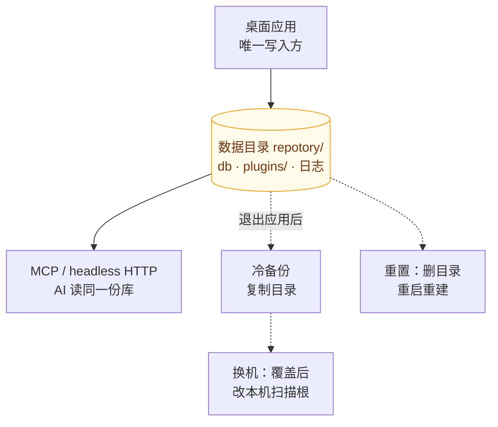

# 数据与备份

Repotory 是本地优先应用：没有云服务与账号体系，全部知识数据（笔记、待办、项目元数据、统计）只存在于本机一个 SQLite 数据库中。AI（如 Claude Code）通过 MCP 读取的也是这份本机数据。因此**备份 = 复制一个目录，迁移 = 搬运一个目录**。



读图：中间那个方框是**唯一的事实源**——桌面应用写入，AI 侧读同一份库，备份、迁移、重置三个操作全部只是对它的复制或删除。这也解释了本页两个关键约束：数据库是 WAL 模式（运行中直接复制可能丢失未落盘的 `-wal` 内容，所以备份前要**先退出应用**），以及扫描根以**绝对路径**存库（换机后必须到设置里改成本机路径）。

## 数据都在哪

| 内容 | 位置 |
|------|------|
| 数据库（含笔记、待办、版本历史、统计、扫描根配置） | 见下表「数据目录」中的 `repotory.db` |
| 插件 | 数据目录下 `plugins/` |
| 日志 | 平台日志目录（见[故障排查](troubleshooting.md#日志文件位置)） |

数据目录：

| 平台 | 路径 |
|------|------|
| macOS | `~/Library/Application Support/repotory/` |
| Windows | `%APPDATA%\repotory\` |
| Linux | `~/.config/repotory/` |

## 备份

### 冷备份（复制目录）

1. **退出 Repotory**（数据库为 WAL 模式，运行中直接复制可能丢失未落盘的 WAL 内容）
2. 复制整个数据目录 `repotory/`（或至少 `repotory.db` 与 `repotory.db-wal` / `repotory.db-shm`）

建议在更换磁盘、大版本升级前做一次冷备份；日常也可以把数据目录纳入你的时间机 / 文件历史等整盘备份。

### 内置每日快照（L1，默认开）

应用启动与每小时重试时会用 `VACUUM INTO` 产出当天快照，落在数据目录的 `backups/` 下（`repotory-YYYY-MM-DD.db`，权限 0600）；每天首份成功后当天其余尝试都是 no-op。轮转默认保留 14 份（`backup_retain` 可调）。设置 → 操作里有「立即备份」按钮；`backup_enabled=0` 可整体关闭（关闭后手动/定时都会被明确拒绝）。

### 远端推送（L2，默认关）

可选的异地副本：在 **设置 → 操作 → 数据库备份** 里配置一个 S3 兼容对象存储（AWS S3、Cloudflare R2、NAS 上的 MinIO 均可），每日本地快照生成后会自动上传到你的桶。隐私门与 AI 功能一致——**凭据未配置 = 零外发**，且只上传快照副本，活库文件与 WAL/SHM sidecar 绝不上传。对象名就是快照文件名（`<前缀>/repotory-YYYY-MM-DD.db`，前缀默认 `repotory`），当天已存在即跳过，上传失败下一小时自动重试。

配置键（设置页或 `UpdateConfig`）：`backup_remote_enabled`（开关）、`backup_remote_endpoint`、`backup_remote_bucket`、`backup_remote_prefix`（可选）、`backup_remote_access_key`、`backup_remote_secret_key`。

### 异盘副本（L3，默认关）

给「只有一块盘」的人准备的第二份：填一个目录（外置硬盘、NAS 挂载、已存在的同步目录都行），每日本地快照生成后会自动把**快照副本**复制过去。留空 = 完全关闭（不建目录、不写文件、不探测）。

两件事值得知道：

- **复制前会校验副本能不能打开**。恢复不了的副本比没有副本更危险——它会让你以为「我还有备份」。所以校验不过的副本不会被发布成那个文件名。
- **它会告诉你「这块盘和活库是不是同一块」**。备份目录和活库同盘时，那份「备份」只是故障那一份的另一个副本，而这一点从路径上看不出来：「隔一个文件夹的备份目录」和「外置盘上的备份目录」长得一模一样。设置页点「检查目录」就能看到结论；同盘是**提醒**不是拒绝（副本照做，也许你要的就是一份防误删的副本）。

写入纪律：目标目录是**你的**目录，轮转只删整名匹配 `repotory-YYYY-MM-DD.db` 的文件（`repotory-notes.db` 这种只是长得像的文件绝不动），副本权限 0600，先写临时文件再原子改名发布。

配置键：`backup_copy_dir`（绝对路径，空 = 关闭）。

### 恢复演练（一条命令）

备份的意义只有在「真的能恢复」时才成立。一份从没被恢复过的备份是个假设，不是备份——而最先崩掉的假设恰恰是最无聊的那个：服务起得来，但 FTS 索引是空的，或者数据目录悄悄指向了活库而不是副本。

`scripts/verify-restore.sh` 把恢复演练变成一条命令：

```bash
bash scripts/verify-restore.sh                                   # 验最新的那份快照
bash scripts/verify-restore.sh /path/to/repotory-2026-10-28.db    # 验指定的那份
bash scripts/verify-restore.sh --query "登录"                     # 指定检索词
```

它做的事：把快照**复制**到临时目录，在隔离的 `HOME` 里起一个无头 server，然后问它四个问题——`/health` 答不答、笔记还剩多少、已批准的页面还剩多少、拿快照自己的标题去检索能不能命中——最后再比一次快照的 sha256，证明演练全程没写过它。结论只有两句：

```text
== Repotory restore drill ==
snapshot : .../backups/repotory-2026-10-28.db
sha256   : bf7de398462612c2179e61249c2f2a4fbd3d3872bd688be746084dfeabc781b4
integrity: ok (sqlite quick_check)
health : ok (version 2.18.0)
notes  : 136
pages  : 27 approved page(s)
search : 'ADR-0005' -> 3 hit(s)
OK    the snapshot is byte-identical before and after the drill
PASS  this snapshot can bring the knowledge back
```

几个刻意的选择：

- **默认用当前工作区编译出的 server**（机器上有 Go 时），而不是装着的那个二进制——否则一个旧版本会把一份完好的快照判成坏的，那正是「好备份被冤死」的典型路径。`--server PATH` 可以指定别的二进制。
- **索引空掉 = FAIL**。FTS5 索引与内容表失配时，检索会**静默少返回结果**：库看起来还在，东西却少了。这类「看起来能用」的快照必须判失败，而不是让它继续冒充备份。
- **全程只读**。活库一次都不打开；快照只被复制与哈希，从不原地打开，校验与检索都发生在隔离 `HOME` 里的那份副本上。
- **坏快照立刻出局**。副本的 `quick_check` 没过就直接失败，不会浪费一次编译去起一个注定起不来的服务。

### Docker 部署（headless，NAS/homelab）

仓库根提供 `Dockerfile` 与 `docker-compose.yml`：单容器跑 `repotory-server`（同源托管前端），数据卷挂在 `/data`。数据目录由 `XDG_CONFIG_HOME=/data` 定位到卷内（`/data/repotory/repotory.db`），备份快照自然落在 `/data/repotory/backups/`——把该目录再纳入宿主机的备份计划即可。远端推送在容器内同样通过 `backup_remote_*` 配置键启用。

```bash
docker compose up -d --build     # 默认端口 18765，浏览器打开 http://localhost:18765
```

> 服务仍**只绑定容器内所有接口但无认证**——不要把端口直接暴露到公网；远程访问请先补认证（见 `docs/api/reference.md` 的信任边界说明）。

## 换机迁移

1. 旧机器：退出应用，复制数据目录
2. 新机器：[安装 Repotory](getting-started.md#下载安装)，**先启动一次再退出**（让应用建好目录结构与 schema）
3. 用备份的数据目录覆盖新机器上的 `repotory/`，重新启动

注意：扫描根目录以**绝对路径**存于数据库。如果新机器的用户名或目录结构不同，启动后到 **设置 → 扫描目录** 中改成本机路径，再点「重新扫描」。仓库位置变了的话，项目分组（Monorepo 拆分/合并记录）按新路径重新识别即可，笔记与待办不受影响。

## 重置

应用内没有「恢复出厂」按钮，重置 = 删除数据目录后重启：

```bash
# macOS 示例：先退出应用
rm -rf ~/Library/Application\ Support/repotory
```

重启后会重新播种默认扫描根、重建空数据库。**这会清空全部笔记与待办**，操作前确认已有备份。

只清统计、保留笔记没有内置开关：如需如此，删除数据库前先在知识库中[导出笔记](features/knowledge.md#导出)，重置后再导入。

## 卸载

1. 删除二进制（安装脚本装在 `/usr/local/bin/repotory`；Windows 为 `%LOCALAPPDATA%\Repotory\repotory.exe`，或你手动放置的位置）
2. 删除数据目录（见上表）与日志（`~/Library/Logs/repotory.log` 等平台日志路径）
3. 如安装过 PWA：在系统/浏览器的应用列表中移除 Repotory

## 相关页面

- [快速开始](getting-started.md)：数据与日志位置速览
- [故障排查](troubleshooting.md)：日志定位与常见问题
- [存储结构优化与 AI 价值](storage-optimization.md)：为什么知识库比让 AI 直接读 git 更好
