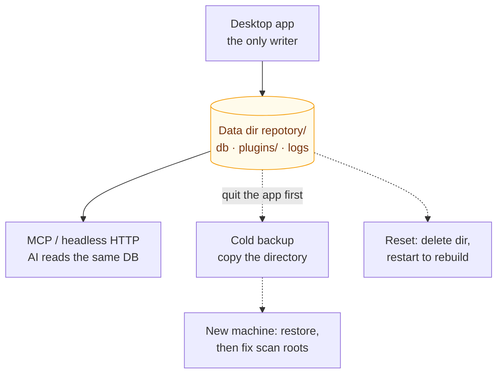

# Data and Backup

Repotory is a local-first app: there are no cloud services or accounts, and all knowledge data (notes, todos, project metadata, statistics) lives only in a single SQLite database on your machine. AI clients such as Claude Code read that same local data over MCP. That means **backing up = copying one directory, and migrating = moving one directory**.



How to read it: the box in the middle is the **single source of truth** — the desktop app writes it, the AI side reads the same database, and backup / migration / reset are all just a copy or a deletion of it. That is also where this page's two constraints come from: the database runs in WAL mode (copying it while the app is running can lose un-flushed `-wal` content, so **quit the app before backing up**), and scan roots are stored as **absolute paths** (after migrating machines you must change them to the new paths in Settings).

## Where the Data Lives

| Item | Location |
|------|------|
| Database (notes, todos, version history, statistics, scan root configuration) | `repotory.db` inside the data directory in the table below |
| Plugins | `plugins/` under the data directory |
| Logs | Platform log directory (see [Troubleshooting](troubleshooting.md#log-file-locations)) |

Data directory:

| Platform | Path |
|------|------|
| macOS | `~/Library/Application Support/repotory/` |
| Windows | `%APPDATA%\repotory\` |
| Linux | `~/.config/repotory/` |

## Backup

### Cold backup (copy the directory)

1. **Quit Repotory** (the database runs in WAL mode; copying it while the app is running can lose WAL content that has not been flushed to disk)
2. Copy the entire data directory `repotory/` (or at least `repotory.db` together with `repotory.db-wal` / `repotory.db-shm`)

We recommend taking a cold backup before swapping disks or upgrading to a major version; day to day, you can also include the data directory in your whole-disk backups such as Time Machine or File History.

### Built-in daily snapshot (L1, on by default)

At app startup and on hourly retries the app produces the day's snapshot with `VACUUM INTO`, written under `backups/` in the data directory (`repotory-YYYY-MM-DD.db`, permission 0600); after the first success of the day every further attempt is a no-op. Rotation keeps 14 snapshots by default (`backup_retain`). Settings → Actions has a "Back up now" button; `backup_enabled=0` turns the feature off entirely (both manual and scheduled runs are then explicitly refused).

### Remote push (L2, off by default)

An optional off-site copy: configure an S3-compatible object store under **Settings → Actions → Database backup** (AWS S3, Cloudflare R2, MinIO on a NAS — all work) and each daily local snapshot is uploaded to your bucket after it is created. The privacy gate matches the AI features — **nothing configured = zero egress** — and only the snapshot copy is ever uploaded, never the live database file or its WAL/SHM sidecars. The object name is the snapshot filename itself (`<prefix>/repotory-YYYY-MM-DD.db`, prefix defaults to `repotory`); an object that already exists skips the upload, and a failed upload retries within the hour.

Config keys (settings page or `UpdateConfig`): `backup_remote_enabled` (switch), `backup_remote_endpoint`, `backup_remote_bucket`, `backup_remote_prefix` (optional), `backup_remote_access_key`, `backup_remote_secret_key`.

### Off-disk copy (L3, off by default)

The second copy for people who only have one disk: fill in a directory (an external drive, a NAS mount, an existing synced folder all work) and every daily local snapshot is copied there automatically. Leave it empty = completely off (no directory created, no file written, nothing probed).

Two things worth knowing:

- **The copy is verified before it counts.** A copy you cannot restore is worse than no copy — it lets you believe "I have a backup". So a copy that fails the check is never published under that name.
- **It tells you whether the directory is on the same disk as the live database.** A backup on the same disk as the database is just another copy of the thing that failed, and you cannot see it by looking at the path: "a backup folder one folder away" looks exactly like "a backup folder on an external drive". Press "Check directory" in the settings to see the verdict. Same disk is an **advice, not a refusal** — the copy is still made, because you may want a copy that protects against accidental deletion.

Write discipline: the target directory is **yours**, so rotation only deletes files whose whole name matches `repotory-YYYY-MM-DD.db` (a file that merely looks like ours, `repotory-notes.db`, is never touched), the copy is 0600, and it is published by an atomic rename from a temp file.

Config key: `backup_copy_dir` (absolute path, empty = off).

### Restore drill (one command)

A backup only means something once it has actually been restored. A backup nobody has ever restored is a hypothesis, not a backup — and the hypothesis that breaks first is the boring one: the server starts, but the FTS index is empty, or the data dir resolution quietly points at the live database instead of the copy.

`scripts/verify-restore.sh` turns the restore drill into one command:

```bash
bash scripts/verify-restore.sh                                   # the newest snapshot
bash scripts/verify-restore.sh /path/to/repotory-2026-10-28.db    # a specific one
bash scripts/verify-restore.sh --query "登录"                     # a specific search term
```

What it does: it **copies** the snapshot into a temp directory, starts a headless server there with an isolated `HOME`, and asks it four questions — does `/health` answer, how many notes are left, how many approved pages are left, and does a full-text search for a term taken from the snapshot itself hit anything — and finally re-reads the snapshot's sha256 to prove the drill never wrote to it. The verdict is one of two lines:

```text
== Repotory restore drill ==
snapshot : .../backups/repotory-2026-10-28.db
sha256   : bf7de398462612c2179e61249c2f2a4fbd3d3872bd688be746084dfeabc781b4
integrity: ok (sqlite quick_check)
health : ok (version 2.18.0)
notes  : 136
pages  : 27 approved page(s)
search : 'ADR-0005' -> 3 hit(s)
OK    the snapshot is byte-identical before and after the drill
PASS  this snapshot can bring the knowledge back
```

A few deliberate choices:

- **It uses a server built from the current checkout by default** (when Go is installed) rather than whichever binary happens to be installed — otherwise a stale version condemns a perfectly good snapshot, which is the classic way a good backup gets wrongly declared dead. Pass `--server PATH` to pin a specific binary.
- **An empty index = FAIL.** When the FTS5 index drifts from the content table, search **silently returns less**: the library still looks there, but things are missing. A snapshot in that state has to fail rather than keep posing as a backup.
- **Read-only throughout.** The live database is never opened; the snapshot is only copied and hashed, never opened in place, and both the integrity check and the search run against the copy inside the isolated `HOME`.
- **A broken snapshot is out immediately.** If the copy fails `quick_check` the drill fails there and then, instead of spending a build on a server that was never going to come up.

### Docker deployment (headless, NAS/homelab)

The repository root ships a `Dockerfile` and `docker-compose.yml`: a single container running `repotory-server` (serving the frontend from the same origin), with the data volume mounted at `/data`. The data directory is located inside the volume via `XDG_CONFIG_HOME=/data` (`/data/repotory/repotory.db`), so snapshots land in `/data/repotory/backups/` — include that directory in your host's backup plan as well. The remote push is enabled inside the container through the same `backup_remote_*` config keys.

```bash
docker compose up -d --build     # default port 18765, open http://localhost:18765
```

> The service still runs **without authentication** — do not expose the port directly to the public internet; add an authentication layer before any remote access (see the trust-boundary note in `docs/api/reference.md`).

## Migrating to a New Machine

1. Old machine: quit the app and copy the data directory
2. New machine: [install Repotory](getting-started.md#download-and-install), then **launch it once and quit** (so the app creates the directory structure and schema)
3. Replace the `repotory/` directory on the new machine with your backed-up copy, then start the app again

Note: scan roots are stored in the database as **absolute paths**. If the new machine has a different username or directory layout, open **Settings → Scan Directories** after launch, update them to the local paths, and click **Rescan**. If repositories have moved, project grouping (monorepo split/merge records) is simply re-detected from the new paths; notes and todos are unaffected.

## Reset

There is no factory-reset button in the app; resetting means deleting the data directory and restarting:

```bash
# macOS example: quit the app first
rm -rf ~/Library/Application\ Support/repotory
```

After restarting, the default scan roots are re-seeded and an empty database is recreated. **This wipes all notes and todos** — make sure you have a backup first.

There is no built-in switch to clear statistics while keeping notes. If you need that, [export your notes](features/knowledge.md#export) from the knowledge base before deleting the database, and import them again after the reset.

## Uninstall

1. Remove the binary (the install script puts it at `/usr/local/bin/repotory`; on Windows it is `%LOCALAPPDATA%\Repotory\repotory.exe`, or wherever you placed it manually)
2. Delete the data directory (see the table above) and the logs (`~/Library/Logs/repotory.log` and the other platform log paths)
3. If you installed the PWA: remove Repotory from the system or browser app list

## Related Pages

- [Getting Started](getting-started.md): a quick look at data and log locations
- [Troubleshooting](troubleshooting.md): locating logs and common issues
- [Storage Optimization and AI Value](storage-optimization.md): why the knowledge base beats letting the AI read git directly
