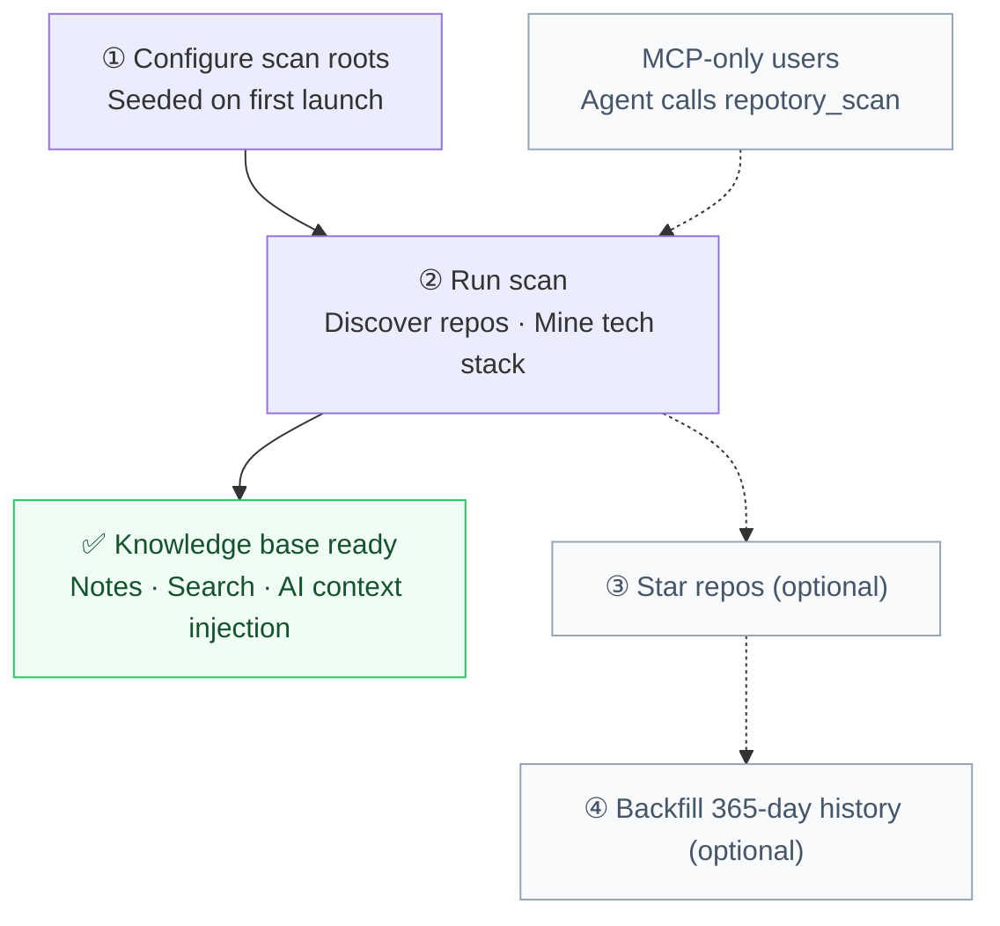

# Getting Started

Repotory is the local-first memory layer and workbench for AI coding agents. Its core value is establishing a **persistent, cross-agent project memory**: it automatically discovers local Git repositories and captures architecture decisions, gotchas, dependencies, and tech stacks, enabling any AI agent to access project context in a single tool call.

The project ships as a **multi-artifact suite**. You can choose the entry point that best matches your workflow:
- **MCP-Only Mode**: No GUI required. Register local memory with Claude Code, Cursor, and Windsurf in a single command.
- **Desktop Workbench Mode**: A native single-file desktop application (Wails v2 + React 19) offering visual note management, todo tracking, and a human-gated review queue.

---

## Quick Access

### Option A: Connect Your AI Agents (Fastest, No GUI Required)

If your daily development revolves around Claude Code, Cursor, or Windsurf in the terminal/IDE, simply install `repotory-mcp` and register it:

```bash
# 1. Download and install repotory-mcp (macOS / Linux)
curl -fsSL https://raw.githubusercontent.com/sky-jiangcheng/repotory/master/scripts/install.sh | bash

# 2. Automatically register MCP with installed agents + configure session auto-capture hooks
node scripts/repotory-init/index.mjs --with-hook

# Or add manually to Claude Code:
claude mcp add repotory -- "$(which repotory-mcp)"
```

Once registered, have your agent run `repotory_scan()` once in your project directory to bootstrap the knowledge base.

---

### Option B: Install the Desktop App (GUI Workbench)

If you prefer a visual knowledge base, block-based Markdown editor, and human review queue:

#### macOS / Linux One-Line Script
```bash
curl -fsSL https://raw.githubusercontent.com/sky-jiangcheng/repotory/master/scripts/install.sh | bash
```
> Installs to `/Applications/Repotory.app` on macOS and `/usr/local/bin/repotory` on Linux; also places `repotory-mcp` in your PATH.

#### Windows One-Line Script
```powershell
iwr -useb https://raw.githubusercontent.com/sky-jiangcheng/repotory/master/scripts/install.ps1 | iex
```

#### Package Managers & Direct Download
- **Homebrew (macOS)**: `brew install --cask sky-jiangcheng/repo/repotory`
- **Scoop (Windows)**: `scoop install repo/repotory`
- **Direct Downloads**: Grab `.dmg` / `.tar.gz` / `.zip` from [GitHub Releases](https://github.com/sky-jiangcheng/repotory/releases).

---

## First Launch & 5-Minute Walkthrough

Launching opens the desktop window directly.

The initial walkthrough is visualised below: the first two steps are required; the remaining two steps are optional enhancements for dashboard metrics. MCP-only users simply have their agent call `repotory_scan`:



> **The boundary between solid and dashed lines marks when the knowledge base is fully usable**: once step ② completes, note-taking, full-text search, and AI context injection are operational. Steps ③ and ④ only enrich dashboard metrics.

### 1. Configure Scan Directories

Default scan roots are seeded automatically on first launch:

| Platform | Default scan scope |
| :--- | :--- |
| **macOS** | Current user HOME directory |
| **Linux** | Current user HOME directory |
| **Windows** | All drives except C: |

You can add or remove root directories under **Settings → Scan Directories** (supports 1–2 directory depth levels).

### 2. Run a Scan

Click **Rescan** on the dashboard. The application recursively discovers all Git repositories under your scan roots and groups them intelligently into projects.

> The initial scan registers repository metadata and tech stacks without scanning historical commits. **The knowledge base is immediately ready to use.**

### 3. Star Repositories (Optional, Dashboard Statistics)

Click the star icon on project cards to star repositories you care about. Starred cards display detailed metrics (additions today, file changes, team contributions).

### 4. Backfill History (Optional, Dashboard Statistics)

Click **Backfill History** on starred cards to asynchronously fetch the past 365 days of commit activity, populating the progress ring and activity heatmap.

### 5. Write Your First Knowledge Note

The real power of Repotory comes from saving reusable insights:
- **Desktop**: Select a project in **Quick create note** on the home page and record gotchas or setup instructions (see [Knowledge Base and Notes](features/knowledge.md));
- **AI Side**: At session end, calling `repotory_handoff` automatically saves a handoff note, which is pinned to the top of subsequent sessions via `repotory_context` (see [AI Integration](features/ai-integration.md)).

### 6. Import Existing Agent Memory (Optional)

If you already have memory logs from Claude, Codex, OpenCode, OpenClaw, or Hermes, you can import them idempotently under **Settings → Plugins**. See [Knowledge Source Import](plugins/overview.md).

---

## Core Capability Matrix

| Capability | Tier | Description |
| :--- | :--- | :--- |
| **Knowledge Base** | Core | Cross-project note hub: Markdown `/` block editor, tags, pinning, FTS5 full-text search, version history |
| **Repo Mining** | Core | Automatically extracts README, tech stack (20+ formats), language breakdown, dependencies, contributors |
| **Project Retrieval** | Core | Global command palette `⌘/Ctrl+K`, global full-text search, fast project context jump |
| **AI Memory Interfaces** | Core | llms.txt, note export, `repotory-mcp` with 18 tools (including `repotory_context` / `repotory_handoff`) |
| **Dashboard & Metrics** | Supporting | Daily goal progress ring, project cards, activity trend lines, Git commit heatmap |
| **Memory Importers** | Built-in | 8 idempotent agent memory importers (see [Knowledge Source Import](plugins/overview.md)) |

---

## Data and Log Locations

All data is stored locally in a single SQLite database per user:

| Item | macOS | Windows | Linux |
| :--- | :--- | :--- | :--- |
| **Database** | `~/Library/Application Support/repotory/repotory.db` | `%APPDATA%\repotory\repotory.db` | `~/.config/repotory/repotory.db` |
| **Snapshots** | `…/repotory/backups/` (daily backups, 14 kept) | `…/repotory\backups\` | `…/repotory/backups/` |
| **Logs** | `~/Library/Logs/repotory.log` | `%APPDATA%\repotory\logs\repotory.log` | `$XDG_STATE_HOME/repotory/repotory.log` |

Database schema migrations run automatically during version upgrades. For troubleshooting, see [Troubleshooting](troubleshooting.md).

---

## Building from Source

Requirements: **Go 1.26+**, **Node.js 20+**, optional [Wails CLI](https://wails.io) v2.13+.

```bash
# 1. Frontend build (assets are embedded into the Go binary)
cd web && npm install && npm run build && cd ..

# 2. Build Desktop App & MCP Server
go build -ldflags="-s -w" -o repotory .
go build -o repotory-mcp ./cmd/mcp/
```

Dev mode: `wails dev` (desktop hot reload); test suite: `go test ./...`, frontend `npm test && npm run build`.

---

## Next Steps

- [Data & Backup](data-management.md): Backup strategy, machine migration, and uninstallation
- [AI Integration](features/ai-integration.md): MCP tool calls and automated session handoffs
- [Knowledge Base & Notes](features/knowledge.md): Markdown editor and full-text search
- [Project Details](features/project-detail.md): Repository mining and dependency analysis
- [Architecture](architecture.md): System layering and data flows
