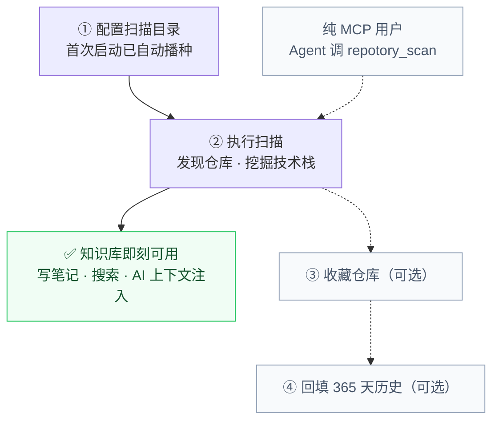

# 快速开始

Repotory 是面向 AI 编程 Agent 的本地优先记忆层与工作台。其核心价值在于建立**跨 Agent 的持久化项目记忆**：自动发现本机 Git 仓库，沉淀架构决策、避坑记录、依赖与技术栈，让任何 AI Agent 一次工具调用即可接入上下文。

本项目提供**多形态产物**，你可以根据实际需要选择最适合的上手方式：
- **纯 MCP 模式**：无需桌面界面，一条命令为 Claude Code / Cursor / Windsurf 注册本地记忆；
- **桌面工作台模式**：单文件原生桌面应用（Wails v2 + React 19），提供笔记浏览、待办看板与人机审核队列。

---

## 快速接入

### 方式 A：为 AI Agent 接入记忆（无需桌面应用）

如果你主要在终端或 IDE 里使用 Claude Code、Cursor、Windsurf，只需安装 `repotory-mcp` 并一键注册：

```bash
# 1. 下载并安装 repotory-mcp（macOS / Linux）
curl -fsSL https://raw.githubusercontent.com/sky-jiangcheng/repotory/master/scripts/install.sh | bash

# 2. 一键注册 MCP 到所有已安装 Agent 并配置会话自动交接钩子
node scripts/repotory-init/index.mjs --with-hook

# 或者在 Claude Code 中手动添加：
claude mcp add repotory -- "$(which repotory-mcp)"
```

注册完成后，让 Agent 在项目目录下执行一次 `repotory_scan()` 即可完成初始化。

---

### 方式 B：安装桌面应用（GUI 工作台）

如果你希望拥有可视化的知识库管理、Markdown 块编辑器和人机审核队列：

#### macOS / Linux 一键脚本
```bash
curl -fsSL https://raw.githubusercontent.com/sky-jiangcheng/repotory/master/scripts/install.sh | bash
```
> macOS 安装到 `/Applications/Repotory.app`，Linux 安装到 `/usr/local/bin/repotory`；同时都会把 `repotory-mcp` 放入 PATH。

#### Windows 一键脚本
```powershell
iwr -useb https://raw.githubusercontent.com/sky-jiangcheng/repotory/master/scripts/install.ps1 | iex
```

#### 包管理器与二进制直接下载
- **Homebrew (macOS)**：`brew install --cask sky-jiangcheng/repo/repotory`
- **Scoop (Windows)**：`scoop install repo/repotory`
- **二进制下载**：访问 [GitHub Releases](https://github.com/sky-jiangcheng/repotory/releases) 下载 `.dmg` / `.tar.gz` / `.zip`

---

## 首次启动与五分钟上手

打开桌面应用后即可直接进入工作台。

上手流转图如下：前两步为核心必须，后两步为可选的统计拓展；纯 MCP 用户只需让 Agent 调用 `repotory_scan` 即可完成：



> **实线与虚线的分界就是「知识库可用」的边界**：第 ② 步完成，笔记、全文搜索、AI 会话注入即全部可用。第 ③ ④ 步仅为丰富仪表盘统计，不影响核心功能。

### 1. 配置扫描目录

首次启动会自动播种默认扫描根目录：

| 平台 | 默认扫描范围 |
| :--- | :--- |
| **macOS** | 当前用户 HOME 目录 |
| **Linux** | 当前用户 HOME 目录 |
| **Windows** | 除 C: 盘外的所有磁盘 |

可在 **设置 → 扫描目录** 中自由增删根目录（支持 1-2 级扫描深度）。

### 2. 执行扫描

在工作台点击 **重新扫描**（Rescan），应用将递归发现根目录下的所有 Git 仓库并智能识别分组。

> 首次扫描仅登记仓库元数据与技术栈，不预扫历史提交数据。**到这一步知识库已全面可用**。

### 3. 收藏仓库（可选，仪表盘统计）

在工作台点击星标收藏你重点关注的仓库，卡片将展示完整统计（今日新增、文件变动、团队贡献等）。

### 4. 回填历史数据（可选，仪表盘统计）

在已收藏的仓库卡片上点击 **刷新历史**，将异步回填近 365 天的每日提交统计，热力图与进度环随之点亮。

### 5. 沉淀第一条知识笔记

让本地知识库发挥最大价值的关键，是记录一条对后续会话有价值的知识：
- **桌面端**：首页 **快速创建笔记** 选定项目，记录运行方式或关键坑点（详见[知识库与笔记](features/knowledge.md)）；
- **AI 侧**：会话结束时调用 `repotory_handoff` 自动生成交接笔记，下一次会话启动时由 `repotory_context` 自动顶置读取（详见[AI 集成](features/ai-integration.md)）。

### 6. 导入现有的 Agent 记忆（可选）

如果你已在 Claude / Codex / OpenCode / OpenClaw / Hermes 中积累了记忆文件，支持一键无缝导入。在 **设置 → 插件** 中即可按需触发导入。详见[知识源导入](plugins/overview.md)。

---

## 核心能力矩阵速览

| 功能模块 | 定级 | 说明 |
| :--- | :--- | :--- |
| **知识库** | 核心 | 跨项目笔记中心：Markdown `/` 块编辑器、标签、置顶、FTS5 全文搜索、版本历史 |
| **仓库深度挖掘** | 核心 | 自动提取 README 摘要、技术栈识别（20+ 格式）、语言占比、依赖关系、贡献者 |
| **项目理解与检索** | 核心 | 全局快捷键 `⌘/Ctrl+K`、全局全文搜索、项目上下文直达 |
| **AI 记忆接口** | 核心 | llms.txt、笔记导出、`repotory-mcp` 18 个 MCP 工具（含 `repotory_context` / `repotory_handoff`） |
| **仪表盘与统计** | 支持 | 每日目标进度环、项目卡片、趋势折线图、Git 提交热力图 |
| **内置记忆导入源** | 内置 | 8 个 Agent 记忆源幂等导入（详见[知识源导入](plugins/overview.md)） |

---

## 数据与日志路径

所有数据统一保存在当前用户本地目录下的单一 SQLite 文件中：

| 内容 | macOS | Windows | Linux |
| :--- | :--- | :--- | :--- |
| **主数据库** | `~/Library/Application Support/repotory/repotory.db` | `%APPDATA%\repotory\repotory.db` | `~/.config/repotory/repotory.db` |
| **自动备份快照** | `…/repotory/backups/`（每日快照，保留 14 份） | `…/repotory\backups\` | `…/repotory/backups/` |
| **运行日志** | `~/Library/Logs/repotory.log` | `%APPDATA%\repotory\logs\repotory.log` | `$XDG_STATE_HOME/repotory/repotory.log` |

系统内嵌自动迁移逻辑，版本升级无需人工干预。排障请参考[故障排查](troubleshooting.md)。

---

## 从源码构建

环境要求：**Go 1.26+**、**Node.js 20+**；桌面调试可选 [Wails CLI](https://wails.io) v2.13+。

```bash
# 1. 前端构建（产物经 go:embed 嵌入二进制）
cd web && npm install && npm run build && cd ..

# 2. 构建桌面端应用与独立 MCP 服务
go build -ldflags="-s -w" -o repotory .
go build -o repotory-mcp ./cmd/mcp/
```

本地联调模式：`wails dev`（桌面前端热更新）；测试全家桶：`go test ./...`，前端 `npm test && npm run build`。

---

## 下一步

- [数据与备份](data-management.md)：备份策略、跨机器迁移与卸载指南
- [AI 集成](features/ai-integration.md)：MCP 工具调用与会话自动交接
- [知识库与笔记](features/knowledge.md)：Markdown 编辑器与全文搜索
- [项目详情](features/project-detail.md)：仓库挖掘与依赖分析
- [架构设计](architecture.md)：系统分层与数据流
