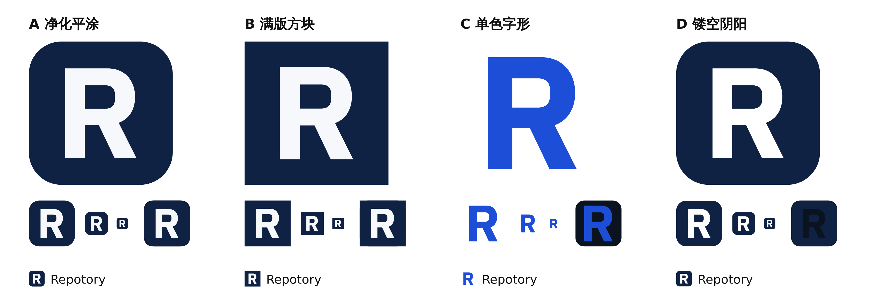
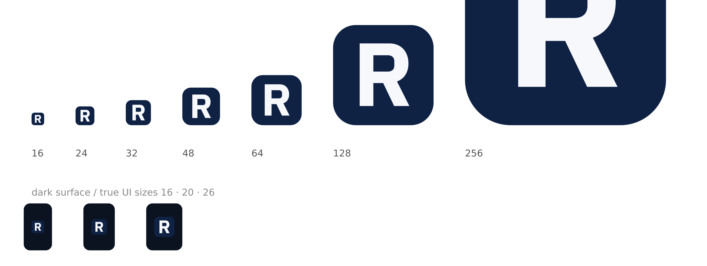

# 图标重构 v4 — 平涂方向

## 问题

v3 的图（圆角方块 + 蓝色渐变 + 4px 内描边 + 340 cap 的白 R）在 512px 下有三个廉价信号叠加：

1. **蓝色渐变** —— 应用商店模板图标的默认皮肤，和 IBM / X 这类单色字标不在一个语域；
2. **内描边** —— 缩小后不是线，是一圈发脏的毛边，看起来像渲染瑕疵；
3. **字撑满画布** —— 字母顶到安全区边缘，没有呼吸，像占位符而不是标识。

真正的元凶不是字形，是这三层装饰。IBM 的 8 条纹、X 的单形状，共同点恰恰是**零装饰**：一个颜色、一个形状、一个记忆点。

## 候选



| 方向 | 做法 | 结论 |
| --- | --- | --- |
| A 净化平涂 | 保留圆角方块，去掉渐变与内描边，平涂深墨，字放大到 320 | **采用** |
| B 满版方块 | 直角满铺，偏终端气质 | 小尺寸下像一个色块，在导航里像复选框 |
| C 单色字形 | 去底色，只留字形（X 式） | 差异最大，但桌面图标变透明底，成败取决于壁纸 |
| D 镂空阴阳 | 字形是挖空的洞 | 白底上等于 A，深色底上字变深，收益不抵复杂度 |

## 构造规范

- 画布 512 × 512，圆角 116（约 22.7%，与 macOS 图标视觉重量一致）
- 底：`#0F2244` 单色平涂，无渐变、无描边、无投影
- 字：`#F6F8FC`，IBM Plex Sans Bold 的 R（© IBM Corp., SIL OFL 1.1）轮廓化
- 字高 320（cap / 画布 = 62.5%）
- 变换：`translate(21.06 13.06) scale(0.941176)`（= 320 / 340 等比缩放 + 视觉重心居中）
  - 外框居中会让 R 读起来偏左：字干一侧重、腿在右下留白。按视觉重心右移 6、上移 2
- 单路径、两个子路径（外轮廓 + 内白），`fill-rule="nonzero"`，内白是真洞
- 16px 仍有内白，32px 起笔画清晰



## 落地

- `build/icon.svg` 仍是唯一事实源；`docs/favicon.svg` 现在**逐字节等于**源文件（无内描边可省，不再维护第二份几何）
- `scripts/generate-icons.mjs` 删掉 `FAVICON_SVG` 常量，衍生图标只剩一份几何
- `BrandMark` 去掉渐变、clipPath 与 `size >= 20` 的 hairline 分支，`variant` 无使用方，一并删除
- VS Code 单色图标用 `translate(0.706 0.706) scale(0.044118)`（0.046875 × 0.941176）落到 24 网格
- `BrandMark.test.tsx` 改为守卫「平涂」：断言 `#0F2244` / `#F6F8FC` 存在，且没有 `linearGradient` / `clipPath` / 任何 `stroke`

## 校验

```bash
node scripts/generate-icons.mjs --check   # 全部衍生图标与源一致
cd web && npm test && npm run build && npm run lint
```

v3（渐变 + 内描边）已被本目录取代，保留作历史对照。
